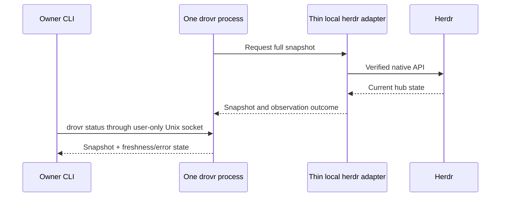

# 02 — Build one service foundation

**Show me — planned slice**

**One package; these are responsibility boundaries, not extra services.**

```text
One npm package                         # planned responsibility sketch
├── service + CLI entrypoints           # shared command/read operations
├── database/config helpers             # SQLite, migration, paths, lock
├── herdr/                              # verified client + observed snapshot
├── profiles/                           # add with real profile work in later goals
├── router/                             # add with real message work in later goals
├── triggers/                           # add with real trigger work in its goal
└── http/                               # add with real private API work in its goal
```

**Startup establishes ownership before exposing useful status.**

```text
service startup                         # conceptual control flow
  read hub config/state paths
  acquire exclusive state-directory process lock
    another live owner → fail clearly
  open SQLite; migrate supported schema with foreign keys + WAL
  start bounded herdr connection/refresh loop
    no current snapshot → report unavailable until full reconciliation succeeds
  serve the user-only Unix socket
  on shutdown: stop listeners/timers, close SQLite, release ownership
```

**The CLI reads the service's observation through one local transport.**



**Connection loss makes observations stale, not authoritative.**

```text
known event or bounded poll
  request a snapshot refresh
on connection loss
  invalidate freshness; report stale/unavailable without hanging
  back off while herdr is down
on reconnect
  reconcile a full snapshot before marking observations fresh
unsupported native capability → named error, never invented behavior
SQLite holds durable facts; observed panes stay in the in-memory cache
```

**What you can validate before profile work.**

```text
Start from delivered build/run recipe → drovr status matches live panes
Move or rename a pane → status refreshes
Stop isolated herdr → status reports stale/unavailable and its cause
Bring herdr back → full reconciliation, then fresh status
Restart drovr → same database reopens and hub reconnects
Start a second drovr → lock error; it cannot take over the live state
Give feedback on startup, freshness, errors, and recovery instructions
```

**Status:** planned. **Depends on:** [01](goal-01.md).

## Outcome

One Node 24 process starts and stops cleanly, owns one SQLite database and one user-only Unix socket, and shows a fresh hub snapshot through a thin herdr adapter. There is no message dispatcher or PWA yet.

## Bounded work

- Create one npm package with TypeScript, `better-sqlite3`, the service/CLI entrypoints, database/config helpers, and the herdr work needed here. Add other feature directories when their real implementation begins; do not create empty future-module scaffolding. Commit an npm lockfile and provide root `npm ci`, `npm run check`, `npm test`, `npm run build`, and `npm start`; use the Node test runner for service logic. Avoid workspaces and a framework skeleton.
- Read hub paths/settings, create the state/config roots with account-only access, and acquire a proven exclusive process lock. A second live service fails clearly; verify crash/stale-lock behavior without building a distributed lease protocol.
- Add a real initial migration with the [final tables](../research/plan-final.md#data-model) and [contract fields](contracts.md). Enable foreign keys and WAL. Keep database helpers local; no generic repository abstraction or duplicate persistent occupants table.
- Implement a small typed local herdr client for verified snapshot, events, bounded visible read, launch, prompt, keys, and terminal observation. Add the operations as needed by later goals; do not prebuild unused command coverage.
- Maintain one in-memory snapshot cache. Known events request a refresh; a bounded poll repairs gaps. On loss/reconnect, invalidate stale observations, reconcile a full snapshot, and back off while herdr is down. Readiness/output observation uses the verified goal 01 surface.
- Choose one request format over the Unix socket and one command/read entrypoint. Expose a small owner-only `drovr status` diagnostic with the hub snapshot and freshness/error state. The CLI reports unavailable instead of hanging. CLI and later HTTP routes will call shared operations, not each other through an extra service.
- Shut down timers/subscriptions/listeners and close the database cleanly. Log ids/error summaries, not message bodies or credentials.

## Out of scope

No ORM, dependency-injection framework, plugin architecture, HTTP owner authentication, profile launch workflow, routing queue, remote adapter, service-manager installer, telemetry, or automatic self-update. Expose only a minimal status/snapshot diagnostic needed to prove this foundation.

## Done when

- [ ] A clean checkout installs with `npm ci` and the committed lockfile, checks, tests, builds, starts against an isolated herdr namespace, and exits using the documented commands. `AGENTS.md` and `CONVENTIONS.md` accurately describe the implemented state and actual working commands rather than retaining their design-only facts.
- [ ] A second process cannot dispatch against the same state directory; a crashed service can be recovered without stealing a live process's lock.
- [ ] A temporary real SQLite database migrates once, reopens with its rows intact, enforces foreign keys/uniqueness, and rejects an unsupported schema version clearly.
- [ ] A live snapshot reaches the CLI. Simulated lost events/reconnect/herdr-down produce a refresh or an explicit stale/unavailable result without a tight retry loop.
- [ ] The adapter rejects unsupported capabilities with a named error. It never invents an output subscription or treats a stale snapshot as permission to type.
- [ ] Normal tests use temporary paths and a controllable adapter boundary; they neither invoke live models nor stop the owner's server.
- [ ] The final hands-on checkpoint has been tried by the owner and revised for feedback before this goal is marked complete.

## Handoff

Give [03](goal-03.md) database/config primitives and the local adapter. Subsequent goals extend these entrypoints and this test suite instead of creating another transport, event loop, or data layer.

## Try it and give feedback

**You get:** a running service and `drovr status`, with exact build/start commands and concrete isolated config/state paths. This checkpoint uses the real hub connection; it needs neither messaging nor a browser.

1. Build and start the service using the supplied recipe; run `drovr status` and compare its panes with the isolated herdr session.
2. Move or rename a sample pane in herdr and run status again to see the refreshed observation.
3. Stop the isolated herdr server, observe the unavailable/stale result, then bring it back and observe recovery.
4. Restart drovr on the same state directory and confirm it can reconnect. Try starting a second instance and read the lock error.

**Expected:** a useful live fleet diagnostic with honest freshness and recovery states, not just a successful process start or a passing test suite.

**Feedback:** Can you tell whether herdr or drovr needs attention? Are the startup command and error messages sufficient to recover without inspecting source? Pause for feedback and improve that experience within this goal.
