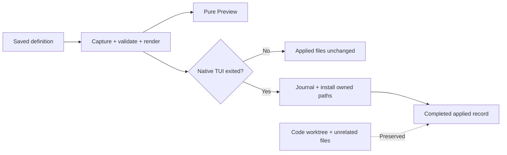

# 03 — Profile files and materialization

**Show me — planned slice**

**Create a scaffold, edit the definition, inspect generated files.**

```text
Name + harness → validated scaffold only; an existing name is an error.
Creation launches nothing and creates no worktree or network connection.

~/.config/drovr/profiles/reviewer/       # owner-authored source
├── profile.json                       # harness, permissions, workspaces, env names
├── AGENTS.md                          # instructions
├── mcp.json
├── skills/<skill>/                    # text, scripts, binary assets, executable bits
├── triggers.json
└── overrides/<harness>/               # native whole-file replacements

~/.local/share/drovr/runs/reviewer/     # Codex example; selected harness only
├── AGENTS.md
├── .codex/config.toml
├── .agents/skills/<skill>/             # copied payload, not a live source link
├── .drovr/
│   ├── applied.json                   # completed apply + managed paths
│   └── applying                       # temporary interrupted-apply journal
└── api/                               # code worktree; owner edits survive
```

**Preview and Apply share one renderer; each operation captures its candidate.**

```text
prepare candidate                      # conceptual flow, not a second renderer
  capture manifest, instructions, skills, triggers, overrides, executable metadata
  reject unstable source capture, skill symlinks, or unsupported common fields
  render the selected harness's native files
  copy complete skill/support payloads; preserve executable bits
  allow only selected native config/skill destinations; reject protected paths
  copy selected native overrides last, replacing whole destination files
  validate final supported native config
Preview → return those files/errors and binary metadata; perform no writes
Apply   → stage and install those same captured bytes after its exit guard
```

**The update boundary protects both runtime files and code.**



**An incomplete apply cannot become a launchable bundle.**

```text
on Apply
  acquire profile operation guard; require confirmed native TUI exit
  reject source changes and unowned destination collisions before native writes
  persist intended managed-path journal; stage/install the captured output
  remove obsolete owned paths, never worktrees or unrelated files
  commit applied metadata and captured profile/trigger copies; clear journal
if interrupted
  block launch until a complete successful apply repairs the bundle
  recover ownership from previous managed paths UNION interrupted journal
```

**What you can inspect and iterate on without launching a harness.**

```text
Owner action             Saved instruction   Applied instruction   Dirty code
Initial fixture          reviewer-A          reviewer-A            retained
Save reviewer-B          reviewer-B          reviewer-A            retained
Preview                  reviewer-B          reviewer-A            retained
Apply after native exit  reviewer-B          reviewer-B            retained

Inspect three harness outputs + executable helper + binary reference asset.
Repeat Apply → equivalent managed output; remove skill → owned copy disappears.
Malformed override, workspace conflict, or edit during capture → useful error.
Give feedback on source files, generated output, and validation messages.
```

Status: planned.

Depends on [01 — Spike](goal-01.md) and [02 — Service](goal-02.md).

## Outcome

A valid profile folder produces the native files for one tested harness in a stable run directory. Repeating materialization preserves the owner's worktrees and produces the same managed files. This goal prepares files; [04](goal-04.md) launches the agent.

Build from the final plan's [Files](../research/plan-final.md#files), [Workspaces](../research/plan-final.md#workspaces), and [Materialization](../research/plan-final.md#materialization), using the shared [contracts](contracts.md).

Use the concrete [profile design](profiles.md) for creation, ownership, saved/applied state, and native output examples.

## Bounded work

- Validate the fixed manifest: profile name, one of three harnesses, `ask` or `workspace`, environment names, and the two documented workspace shapes. Validate optional MCP, skills, overrides, and trigger files. A bad profile has its own error; it does not invalidate the other profiles.
- Add one owner scaffold-creation operation taking name and harness. It creates a validated default folder without launch/worktree/network side effects and refuses existing names. Manually created folders load through the same validator.
- Keep rendering pure so Preview and Apply show/write the same final native files, including copied-last overrides. Track one current applied manifest/managed-path list for safe cleanup and comparison; add no revision history. Reject an unsupported harness change after first launch and conflicting mutation of a provisioned workspace.
- Write three fixed native adapters for the versions recorded by the spike. Each writes instructions, MCP, skills, the same bundled drovr skill, permission settings, and extra-directory settings. Keep adapters as ordinary functions; use no discovery or registration system.
- Copy complete skill/support payloads as bytes and preserve executable bits. Reject skill-tree symlinks in MVP. Preview identifies binary assets and executable files; it never rewrites them or decodes binary data as editable text. Unsupported common-field translations are file-specific validation errors, not discarded warnings.
- Append the workspace instruction pointers described by the final plan. Record the native limits proved by the spike; permission labels do not imply identical command behavior in every harness.
- Create or reuse Git worktrees under `runs/<name>/`. Reuse only a path whose repository and branch match. Resolve a known local default-branch ref before creating a missing branch; if that cannot be established, fail with the action the owner must take. Do not fetch or guess the current feature branch.
- Preserve every file inside the worktree. A checked-out branch elsewhere, unexpected existing directory, or mismatched worktree is an error. No reset, clean, force, branch switch, worktree deletion, or branch deletion.
- Materialize only after the native harness has confirmed exit; paused, idle, and blocked are not sufficient. Capture one complete candidate, render/stage those same bytes, and journal intended managed paths before writes. Refuse unowned-file collisions. Recovery uses previous and interrupted ownership lists; it never replaces the run-directory tree containing workspaces. A failed partial update blocks launch until materialization succeeds.
- Copy the selected raw native overrides last, as the final plan requires. Allow only the selected harness's native configuration/skill paths; reject `.drovr`, workspaces, credential homes, traversal, and escaping symlink targets even when they are inside the run root. Check the resulting supported native config for parse errors; do not add a generic config merge language.
- Keep a plain applied copy of `triggers.json` in the managed run directory. Edits in `~/.config/drovr` do not change a running profile's files or checks. Apply them at the next explicit restart/launch.
- Keep secrets as environment names. Do not expand secret values into config, logs, or command arguments. Display the configuration Git commit or newest file modification time; add no version counter or revision store.
- Provide one development-only materialize-fixture script calling this real materializer, with a documented npm invocation. It creates disposable config/state/workspace inputs and prints generated paths and changes. Do not add a new public agent command or a parallel rendering path just for the demonstration.

## Scope cuts

No profile designer, schema-generated forms, profile import/export, rename workflow, revision digests, immutable snapshots, plugin API, permission DSL, hook system, or remote files. Raw overrides stay raw. No live reload that rewrites a running profile's instructions.

## Done when

- [ ] Fixture profiles for Claude Code, Codex, and the selected OpenCode 2 version produce their expected native paths, one instruction document, one MCP server, and the bundled skill.
- [ ] Creating a profile writes only its scaffold, duplicate creation changes nothing, and Preview matches applied output without touching code, credentials, or a running session.
- [ ] Invalid names, malformed supported config, out-of-root paths, and bad overrides report the affected profile and leave another valid profile usable. Overrides targeting protected in-root paths such as `api/file` or `.drovr/applied.json` fail before writes and preserve those files. Errors never print an environment value.
- [ ] Two consecutive materializations produce equivalent managed files. Removing a managed skill from config removes its old managed copy without touching workspace files or unrelated owner files.
- [ ] A fixture skill retains an executable helper and a binary reference asset. A symlinked skill entry or unsupported common-field translation fails before run-directory writes. An external edit during candidate capture rejects that unstable candidate and preserves the current applied bundle; rerunning uses the complete edited definition.
- [ ] A disposable Git test proves creation from a known local default ref, reuse of the same worktree, refusal of a conflicting branch/path, and preservation of dirty tracked and untracked work.
- [ ] A non-Git extra directory is written to the tested native configuration for each adapter. The spike's discovery and permission evidence is linked rather than assumed.
- [ ] Changing config, instructions, or triggers while a profile is running leaves its applied files unchanged. After confirmed native exit, Apply updates all applicable managed files, including the trigger copy; merely pausing never permits application.
- [ ] An interrupted materialization cannot be mistaken for a completed deployment or launchable profile. Recovery removes a newly added stale managed file even if its apply crashed before manifest commit, preserves unowned files, and never mixes a concurrent edit into the captured bundle.
- [ ] The final hands-on checkpoint has been tried by the owner and revised for feedback before this goal is marked complete.

Use focused file and disposable-repository tests. Actual harness discovery is already a spike gate and is exercised through launch in the next goal; do not build a second compatibility harness here.

## Handoff

[04](goal-04.md) gets one profile loader, one materialization path, and explicit errors. The later Profiles UI calls the same validator when saving raw files; the trigger engine reads the applied trigger copy. Keep file validation and rendering in this module instead of recreating them in HTTP or the scheduler.

## Try it and give feedback

**You get:** the materialize-fixture command, editable sample profiles, and actual native files in disposable run directories. Supply the exact invocation and printed paths; launching a harness is not required at this checkpoint.

1. Run the fixture command for the three supported harnesses and inspect their generated instructions, MCP configuration, and bundled skill, including its executable helper and binary reference asset.
2. Change a sample instruction and add a sample skill. Preview through the fixture without writing the run directory, then apply and inspect the resulting files and executable status.
3. Put tracked and untracked edits in the disposable worktree, rerun materialization, and confirm those edits remain.
4. Introduce a malformed override or a conflicting workspace path and inspect the profile-specific validation error; restore the input and rerun.

**Expected:** understandable profile inputs and predictable native output, with visible updates/errors and preserved code. No launcher or later PWA is needed to inspect and iterate on it.

**Feedback:** Are these files comfortable to edit and are the generated instructions what you intended? Which validation message or native override is confusing? Pause for feedback and adjust the materializer or sample files before continuing.
