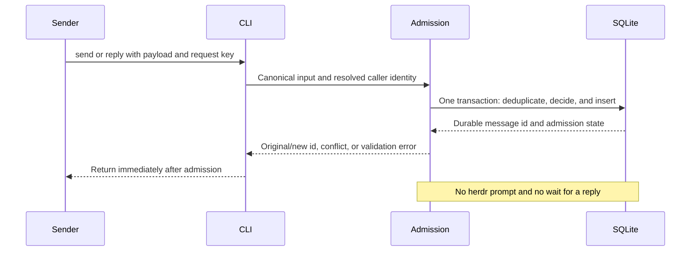

# 05 — Admit messages through two tools

**Show me — planned slice**

**One admission owner; caller identity comes from the hub context**

```text
owner shell                         profile pane
  owner socket context                resolved HERDR_PANE_ID mapping
                  \                 /
                   send / reply CLI
                     shared admission operation
                       SQLite: messages, rules, lineage, request keys
                       owner reads: pending, messages, root/pair threads
ordinary pane / machine prefix / agent alias → not a profile address
TUI prompt submission → goal 06, outside this slice
```

**The response waits for storage, never for a model answer**



**Transaction logic — pseudocode, not a second command path**

```text
validate static payload shape; resolve caller; canonicalize full input
transaction:
  existing sender/request key?
    same canonical input → return original result, consume no new budget
    changed canonical input → conflict; create no second message
  resolve profile target; choose allow decision; compute lineage
  enforce rendered size, depth, fan-out, pending, and root-rate bounds
    defaults: 16 KiB, depth 4, 16 child sends, 64 pending, 4 agent roots/hour
  send → queue, await approval, or persist a well-formed refusal
  profile reply → require a prior attempt for that exact recipient/message
    first reply to an original send may reserve one profile-sender wake
    later reply or reply-to-reply → history only
  insert row and reserve any eligible wake atomically
commit; return durable id/state without submitting a prompt
```

**Concrete identities and decisions stay visible**

```text
owner send, key=k1, text=A       → message m1
same sender, key=k1, text=A     → the same m1; no new decision or budget
same sender, key=k1, text=B     → explicit conflict
new invocation without a key   → new operation with a generated key

builder → reviewer, no rule    → awaiting owner approval
owner allows once             → queued; no reusable allow rule
reviewer replies to attempted send from builder
  first eligible reply        → one reserved wake for builder
  a later different reply     → recorded only
  reply to a reply             → recorded only
reply to owner/trigger send    → owner result; no dispatcher wake
quiet reply                   → body may be empty; quiet/choices are exclusive
choices reply                 → store 2–4 labels; choice UI arrives in goals 08–09
```

**What the owner can inspect before delivery exists**

```text
send with a fixed key → repeat → change payload → inspect id/conflict
send builder → reviewer without a rule → pending → allow once
read messages/root thread → inspect links, decision, and queued state
restart drovr → ids, rules, decisions, and queued rows remain
inspect reviewer's native pane → no queue text was submitted by this goal
feedback → clarify the mailbox output before adding delivery
```

**Status:** planned. **Depends on:** [04](goal-04.md).

## Outcome

`drovr send` and `drovr reply` return immediately after one durable admission. The service can authorize, deduplicate, thread, and bound traffic between known hub profiles. This goal does not type any message into a TUI.

## Bounded work

- Implement one `send`/`reply` command handler shared by CLI and future HTTP/trigger callers. Use the [final envelope/tools](../research/plan-final.md#the-two-tools), request keys, JSON response, exit codes, rendered size cap, and [C1–C3](contracts.md#c1-cli-payloads-and-identity).
- Resolve the caller from the pane/profile mapping or owner socket context. Accept profile names only. Unknown well-formed targets persist a refusal; ordinary panes, `@agent:` syntax, and machine prefixes are not addresses.
- In one SQLite transaction, find duplicate keys, canonicalize input, resolve the target, apply allow/one-time decisions, compute lineage, enforce admission limits, and insert the message. No command constructs its own SQL path around admission.
- Implement owner `allow once`, `allow always`, `allow refuse`, and rule removal. Record the admitting rule so revocation can hold queued work. A profile cannot approve or list owner pending work.
- Add the `operation` discriminator. Reserve first-reply wake rights atomically, keep later replies as history, and make replies to reply rows recorded-only. Choice-linked owner sends remain sends. Do not add a report/finish operation or silently scrape a final answer.
- Add shared read queries for pending work, messages, root threads/transitive links, and the pair filter. Expose a small owner-only `drovr messages` read command so this queue is inspectable before the PWA. Store each row once; order ids numerically. HTTP will reuse these reads.
- Enforce depth, root fan-out, pending capacity, and agent-root rate from durable rows. Read the parent's active id from the runtime row so lineage survives restart. Duplicate requests consume no new budget.

## Out of scope

No prompt submission, blocking `ask`, inbox/wait protocol, automatic reply relay, rooms, batching, model routing, actor registry, profile rename, standalone approval subsystem, or notification just because an ordinary message has no reply. Quiet/choices are stored fields; their UI appears in goals 08–09.

## Done when

- [ ] Same sender/key/payload returns the original id; changed payload conflicts; a new unkeyed invocation is a new row. Test both sends and replies, including concurrent calls.
- [ ] Tests cover owner/profile/ordinary-pane identities, malformed vs unknown targets, all body sources, quiet-only reply, choices validation, and exact rendered UTF-8 size limits.
- [ ] An allowed send queues; a miss awaits approval; once writes no reusable rule; always writes the shown exact rule; refusal and revocation cannot wake a profile.
- [ ] A reply targets the original sender, bypasses only the original request's reverse allow requirement, and cannot answer a message never attempted for that profile. Early/exact-id reply races use the shared contract.
- [ ] Two different concurrent replies reserve at most one wake. Reply-to-reply traffic is history only, so it cannot evade depth/fan-out limits.
- [ ] Depth 4, child 16, pending 64, and new-root hourly bounds survive database reopen; closed history does not exhaust pending capacity, and refusals do not start another prompt.
- [ ] Pair/root queries include linked choice roots without duplicated rows or lexicographic `m10`/`m2` ordering errors.
- [ ] The final hands-on checkpoint has been tried by the owner and revised for feedback before this goal is marked complete.

## Handoff

[06](goal-06.md) consumes admitted rows through one selector. [07](goal-07.md) reuses the same handlers/read queries. Do not wire a shortcut from either transport directly to herdr prompt.

## Try it and give feedback

**You get:** working `send`/`reply`, owner `pending`/`messages` reads, and allow decisions against the real database. Supply both builder and reviewer disposable profile definitions and their exact setup through the existing profile-file and launch paths; goal 04's single reviewer sample is not a prerequisite for a second sample. Deliver copy-paste commands with fixed request keys. This checkpoint exercises a durable mailbox; messages do not reach a TUI until goal 06.

1. Send an owner message with `--request-id`, repeat the identical command, then repeat that key with changed text. Inspect the stable id and explicit conflict using `drovr messages`.
2. In builder's native pane, have it run a send to reviewer without an allow rule. As owner, inspect `drovr pending`, allow it once, and observe the row move to queued without creating an always-allow rule.
3. Write an owner reply to a known message and inspect its link and thread. Do not fabricate a delivered attempt to demonstrate a profile reply; that real path belongs to goal 06.
4. Restart drovr and confirm these ids, decisions, and queued rows remain. Inspect reviewer's native pane to confirm this goal has not typed the queue into it.

**Expected:** a mailbox you can inspect and correct, with nonblocking commands, understandable errors, durable history, and clear approval decisions. Full peer conversation remains the next goal's checkpoint.

**Feedback:** Are ids, send/reply semantics, queue state, and allow-once behavior understandable from the CLI output? Which output makes it hard to tell what will happen next? Pause for feedback and improve this slice before adding delivery.
