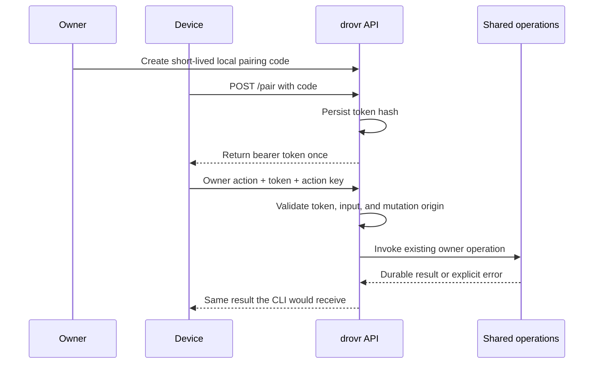

# 07 — Private owner API

**Show me — planned slice**

These views describe planned responsibilities and behavior, not implemented handlers.

**Pair locally, then authenticate each device request.**



**HTTP owns transport and access; existing operations own the rules.**

```text
Private owner API (loopback; owner supplies private HTTPS)
├── Pair/revoke         device access; code exchange is token-free
├── Read models         Attention, fleet, profiles, mailbox pagination
├── Owner actions       same send/reply/allow/recovery/launch operations as CLI
├── Profile files       supported config paths only; validated atomic saves
├── Native preview      shared pure renderer; no application or launch
└── Terminal boundary
    ├── Observation     authenticated stream, bounded buffers, cleanup
    └── Dialog key      current owner card; revalidate runtime and dialog
```

**Guard the two file/pane side effects at their actual boundary.**

```text
on request intake
  enforce documented route body/read limits before unbounded buffering or parsing
  reject over-limit or malformed input without file/database mutation

on profile-file save
  require supported path inside this definition; reject escaping links
  require expected content token; reject a stale edit
  validate candidate → atomically save definition
  leave applied files and the live session unchanged

on dialog-key action
  authenticate device; check mutation origin
  reread current profile/runtime/dialog and compare with card
  if stale or unrecognized → reject without a key write
  otherwise → send only the selected supported dialog key

on stream open / browser close / device revoke
  validate token and upgrade origin / release upstream / close device streams
```

**Observable checkpoint: one action, revocable access, preserved evidence.**

```text
Pair device → GET fleet/profile/Attention → compare with CLI
POST message with key K → durable message M
Retry identical request K → the same M; no second admission
Reuse K with changed input → conflict
Open pane stream → compare real herdr output → close and reopen
Revoke device → next request rejected; its open stream closes
Re-pair → inspect the same message M and its attempt history
Feedback → clarify an error, pairing step, or stream behavior; repeat it
```

Status: planned. Depends on: [06 — Dispatcher](goal-06.md).

## Outcome

The owner can read the fleet and perform the existing CLI actions through one authenticated loopback API. HTTP delegates to the same operations as the CLI; it adds authentication and transport, not a second router. Source: [Attention and the PWA](../research/plan-final.md#attention-and-the-pwa) and [Security](../research/plan-final.md#security).

## Bounded work

- Serve static assets and API from the same service and origin. Listen on loopback only; let the owner supply private HTTPS through `tailscale serve` or a reverse proxy.
- Add local pairing and device-revocation administration. Exchange a short-lived, single-use, rate-limited code for a bearer token; persist its hash and enforce revocation on requests and open terminal streams.
- Reuse the profile catalog, snapshot cache, mailbox queries, and command handlers. Derive Attention on read; persist only dismissals. Paginate message reads by numeric row id and return bounded screen excerpts.
- Authenticate every API operation except code exchange. Validate the configured origin on mutations and stream upgrades. Reuse the request-key conflict behavior from [contracts.md](contracts.md).
- Define and document finite request-body, supported text-file, and request-read limits before implementing these handlers, using the actual profile inputs from goal 03 and existing message constraints as evidence. Enforce byte limits while reading, including chunked/misdeclared bodies, before unbounded buffering/parsing or any mutation. Keep message size/authorization rules in the shared operation; do not replace them with an unrelated HTTP limit.
- Proxy the supported hub terminal observation stream with bounded buffers and disconnect cleanup. Use the adapter verified by the spike; do not translate terminal output into chat.
- Permit dialog keys only through a current owner card. Re-read and match its profile/runtime/dialog before sending the selected key; reject stale or unrecognized actions.
- Add raw profile-file reads/writes for the small editor in goal 08. Limit paths to supported files inside that profile's config directory, reject traversal and escaping symlinks, validate saves, and write atomically. Leave running applied files untouched.
- Expose the existing profile scaffold and pure native-preview operations from [the profile design](profiles.md), plus the saved/applied/runtime projection and explicit `fresh` Launch input. Creation does not launch; preview does not apply. Reject stale file saves rather than overwriting a newer edit.

## Route boundary

Use the minimum routes from the final plan, with only the reads and actions the PWA needs:

| Surface | Handler responsibility |
| --- | --- |
| Pair and revoke device | Authentication administration; never an agent action |
| Attention, agents, profiles, profile files | Existing read models; dismissal writes its item key |
| Create profile / preview native files | Shared scaffold creation and pure renderer; no live-session mutation |
| Messages and thread/pair filters | Mailbox reads, `send`, and `reply` |
| Allow once / always / refuse | Existing owner admission decisions |
| Retry / cancel unresolved message | Existing owner recovery operations from [contracts.md](contracts.md) |
| Profile launch / Stop / Resume | Existing profile and dispatcher operations |
| Current dialog key / terminal stream | Narrow herdr adapter operations |

Document exact request/response schemas alongside these handlers. Add no generic RPC envelope, CRUD generator, or parallel domain model. Trigger-related reads initially show no entries; [09 — Triggers](goal-09.md) supplies the real data later.

## Explicit cuts

No public listener, webhook routes, remote machine API, user accounts/roles, OAuth provider, push, general filesystem endpoint, arbitrary terminal command endpoint, or transcript parser. Profile-file editing is confined to configuration; it cannot edit worktree code. No dedicated stored task-status table or polling agent to compose summaries.

## Done when

- [ ] Every owner command produces the same durable result through CLI and HTTP, including idempotent retries and conflicts; tests invoke the shared operations rather than reimplementing expected rules in HTTP.
- [ ] Pairing succeeds once before expiry. Expired/reused codes fail. Requests without a valid token fail, and revocation rejects the next request and closes that device's live stream.
- [ ] A foreign origin cannot mutate state or open a stream. The configured private origin works through the documented proxy setup.
- [ ] Bounded reads and pagination cannot return an unbounded log or terminal history; closing a browser stream releases its upstream connection.
- [ ] Maximum permitted bodies/text saves work; over-limit, malformed, slow/incomplete, and chunked-overflow requests are bounded and rejected without changing files or durable state. The documented limits and shared message-size rules agree.
- [ ] A current dialog action sends exactly its selected key. A changed runtime or changed dialog rejects the stale action without any key write.
- [ ] A dismissal leaves native herdr focus unchanged. A new completion receives a new item key.
- [ ] File reads/writes reject traversal and symlink escape; a valid save changes config only. A bad save reports its validation error without replacing the last valid file.
- [ ] Herdr-down and unavailable-screen responses are explicit; the API never invents a successful delivery or an empty successful transcript.
- [ ] The final hands-on checkpoint has been tried by the owner and revised for feedback before this goal is marked complete.

## Handoff

Record the route/schema list and private-proxy instructions. [08 — PWA](goal-08.md) consumes these endpoints without adding business logic. [09 — Triggers](goal-09.md) adds trigger data through the same reads and owner operations.

## Try it and give feedback

**You get:** a running private API and a copy-paste CLI/`curl` walkthrough against the previous goal's sample fleet. At delivery, supply its real base URL, request bodies, and exact commands. The recipe reads credentials interactively or from a restricted temporary file; it must not print tokens or embed their values in shell history. No PWA is needed for this checkpoint.

1. Generate a pairing code with the delivered local owner command and exchange it through `POST /pair`. Read `/agents`, `/profiles`, and `/attention` using the resulting device credential.
2. Submit one owner message through `POST /messages`, then repeat the same request key and payload. Read its thread and compare the id with the CLI's view of that message.
3. Open the authenticated sample pane observation using the documented stream-client command. Compare it with the real herdr pane; close the client and reopen it once.
4. Revoke that device using the delivered owner command. Its next API request must fail and any still-open terminal observation must close. Pair again with a new code to continue.

**Expected:** the API exposes the same fleet, message, and recovery state as the CLI. Pairing and revocation are observable without inspecting SQLite, and the terminal view is real output rather than reconstructed chat.

**Feedback:** Are the responses and error messages understandable enough to diagnose a failed action? Is pairing/revocation usable? Return the response or step that needs improvement, then iterate on the API before building the UI on it.
