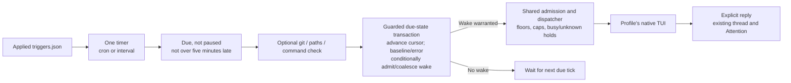

# 09 — Add one trigger engine

**Show me — planned slice**

These views describe the planned timer, transaction, and reply behavior; no second agent loop is added.

**An applied trigger produces an ordinary message through the existing router.**



**Checks are cheap gates with specific limits and blind spots.**

```text
git     → named-worktree HEAD + porcelain; already-dirty edits may be missed
paths   → run-directory size/mtime; no content-change guarantee
command → owner command in run cwd; 30 seconds / 1 MiB stdout maximum
          hash full accepted stdout; render at most 4 KiB; discard stderr
          timeout/overflow → terminate and reap the whole process group

classify check result outside the SQLite transaction
  if error, timeout, overflow, or nonzero exit
    preserve good baseline; safe error summary; no wake
  if first success → candidate baseline; no wake
  if unchanged → do not wake
  if changed → candidate baseline + ordinary wake
commit each result through the guarded state transaction below
```

**Every due occurrence advances scheduling; only eligible results create a wake.**

```text
run any command/check outside the SQLite transaction
transaction for each completed due occurrence
  require current applied trigger, matching generation, and expected next_due
  stale/duplicate completion → no state mutation or admission
  advance next_due; record baseline/error as appropriate, even without a wake
  if changed result or unchecked scheduled wake
    pending unprepared wake → coalesce its data internally
    otherwise → shared admission with the occurrence request key
commit cursor + result + any message together; replay cannot repeat this tick

prepared payload → frozen; coalescing cannot rewrite it
busy or capacity unavailable → one pending wake waits
dispatch → 15-minute trigger floor + 4 proactive deliveries/profile/hour
unknown delivery → hold automatic input for owner recovery
paused or over-five-minutes-late tick → skip without leaving it eligible again
Resume → schedule from now; no catch-up burst
```

**Replies project into existing views; they do not create another workflow engine.**

```text
quiet reply  → stored in thread; hide its result card only
choices      → 2–4 labels; one keyed tap produces one owner send
               new root, linked to the offered reply; retry tap ≠ another send
daily brief  → one displayed slot per profile/local day; browsing makes no call
no reply     → trigger card only after valid attempt close; late reply updates it
errors       → launch/check/unknown-delivery/dialog states remain visible
```

**Observable checkpoint: real timing and visible suppression.**

```text
Apply sample triggers after native exit → launch the disposable profile
First successful check / unchanged input → baseline only; no model wake
Changed input → normal thread wake → quiet reply remains in history
Change again inside 15-minute floor → one wake waits until eligible
Choose a returned label → one linked owner message
Scheduled brief → one local-day slot
Stop + input change + Resume → no burst of skipped occurrences
Fail a check → visible error without another model prompt
Feedback → adjust noise, waiting-time clarity, or result presentation; repeat
```

**Status:** planned. **Depends on:** [06](goal-06.md), [08](goal-08.md).

## Outcome

A hub profile can wake from a saved schedule or a changed cheap check, reply quietly or offer choices, and produce one daily brief. The timer only admits ordinary messages; it never starts a second agent loop or writes directly to herdr.

## Bounded work

- Load the applied `triggers.json` copy, validate cron/every/check fields, and use one timer plus a standard timezone-aware cron parser. Exactly one cadence, one-minute check minimum, 15-minute minimum for unchecked intervals. Do not implement a cron parser or extra worker.
- Implement exactly the final checks: named-worktree HEAD+porcelain; run-directory path size/mtime; owner-authored command in that cwd. Keep the stated fingerprint gaps. First successful observation creates a baseline without a prompt.
- Bound command work at 30 seconds/1 MiB stdout; terminate and reap the whole process group on timeout/overflow, hash accepted full stdout, and cap the rendered data block at 4 KiB. Discard stderr rather than accumulating or forwarding it; errors identify the trigger and exit/timeout/overflow outcome without raw command output. Error/nonzero exit preserves the good baseline and creates an error projection without a model wake.
- Run checks outside SQLite transactions. For every completed due occurrence, revalidate the applied trigger, starting generation, and expected `next_due`, then atomically advance the cursor and record the baseline/error outcome. Baseline-only, unchanged, and failed checks advance scheduling without admitting a wake. Only a changed result or unchecked scheduled occurrence inserts/coalesces one pending wake through shared admission and occurrence request keys. Reject stale/duplicate completions without changing newer state. Pre-prepared coalescing remains an internal update, not a conflicting public resend; use shared queue bounds, dispatch, and rate accounting.
- Enforce the 15-minute per-trigger prompt floor and four proactive deliveries/profile/rolling-hour across all triggers. Capacity unavailable means that one pending wake waits. Skip ticks over five minutes late and paused ticks; Resume starts from now.
- Use the same `reply` message for results. Quiet hides a result card only; choices produce keyed owner sends; a closed trigger turn without a reply yields the final plan's no-reply card. Derive one brief slot per profile/local day without another model call or task table.
- Complete the existing Profiles/Attention raw-trigger editing and result display. Running profiles retain applied triggers until restart. Add no separate scheduler UI or custom goal designer.

## Out of scope

No webhook/private ingress route, event ledger, remote polling, Git fetch, content hashing, directory watcher daemon, agent-authored schedules, natural-language scheduling, delivery batching, per-job worker, push, or automatic retry on a missing reply. `gh` is an owner-configured command using its existing login, not a GitHub integration SDK.

## Done when

- [ ] A cron occurrence creates one durable trigger message in the normal thread; its occurrence key survives crash/restart without duplicating admission. Submission uses the normal uncertainty rules, with no automatic replay; explicit owner Retry can repeat native work.
- [ ] Git/paths/command checks baseline quietly, suppress unchanged inputs, and wake on their documented changes. Demonstrate and document the already-dirty Git and metadata-only paths blind spots rather than adding content hashes.
- [ ] Busy periods coalesce one pending wake, prepared payloads freeze, and two trigger ids cannot evade the profile-wide cap. A `delivery_unknown` attempt blocks further automatic input.
- [ ] Cursor/message commit failures, duplicate timer callbacks, missed ticks, paused periods, stale post-Stop check completions, and timezone/DST boundary cases do not duplicate a wake or create a catch-up burst.
- [ ] Baseline-only, unchanged, and failed checks advance `next_due` and do not rerun within the same cadence. Duplicate callbacks/results and a completion from an older applied trigger/generation cannot advance a newer cursor or admit work.
- [ ] Nonzero/timeout/oversized command failures retain the previous hash and show a safe error; they do not enqueue an empty-result wake or log secrets. Stderr-heavy commands do not grow capture buffers or leak output, and timed-out/overflowing child processes are terminated and reaped.
- [ ] Quiet suppresses no operational error. Missing trigger reply appears only after a valid close; a late reply updates the projection. Ordinary missing replies stay silent.
- [ ] One retried choice tap creates one owner message with a new root/link to the offered reply. Two explicit actions are distinct. Brief display fills one local-day slot and viewing it makes no model call.
- [ ] The final hands-on checkpoint has been tried by the owner and revised for feedback before this goal is marked complete.

## Handoff

The full final-plan feature surface now exists. [10](goal-10.md) proves the release using these same handlers, clocks, fault cases, and UI controls; it adds no new trigger source or scheduler abstraction.

## Try it and give feedback

**You get:** the running PWA and a small local sample input plus applied trigger configuration: a one-minute command check whose prompt can produce quiet/choices replies, and a 15-minute scheduled brief. Supply the exact file paths, configuration, apply/relaunch commands, and next eligible run times at delivery. Use the normal production limits; do not add a hidden fast-clock mode to the application.

1. Apply the samples after the disposable profile's native TUI has exited, then launch it through the documented workflow. Leave the input unchanged for a check tick: baseline and unchanged checks advance to the next displayed due time without waking the agent or rerunning the same occurrence.
2. Change the sample input to request a quiet outcome. At the next eligible check, inspect the trigger message and quiet reply in history; no Ready-for-review result card should appear.
3. Change the input to request choices during the 15-minute floor. Confirm one pending wake waits until the displayed eligible time, then tap one returned choice and inspect its single owner-message result. Allow the scheduled brief to run and find its one local-day slot. This live exercise can take more than 15 minutes; automated fake-clock tests cover boundary cases separately.
4. Stop the profile and change the input again. After a tick and Resume, verify there is no burst of paused occurrences. Use the supplied failing-check input to see a check error without another model prompt.

**Expected:** unchanged checks are quiet, actual changes use the ordinary thread, timing obeys the stated floor, and quiet/choices/brief/error states are visible in the existing views. There is no second scheduler product to operate.

**Feedback:** Are the waiting times and next eligible wake understandable? Is this helpful proactive work or unwanted noise? Return examples and iterate on trigger behavior and presentation within this goal before release validation.
