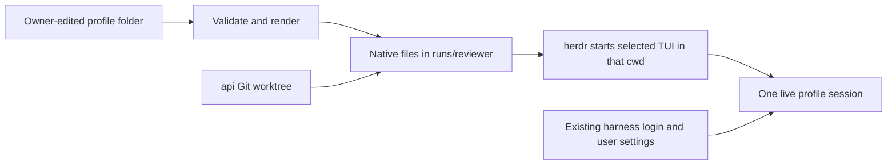

# Profile design: definition, application, and hub runtime

**Show me — planned profile lifecycle**

`@reviewer` is one address, one chosen harness, and at most one live runtime. These are design sketches; the screens, operations, and generated files are not implemented yet.

**What you create and edit.** Creation asks for name + harness. The three tabs separate editable source from applied files and the live session. Component names illustrate responsibility, not an existing component library.

```tsx
<Profiles>
  <NewProfileForm />                 // name + Claude / Codex / OpenCode 2
  <ProfileDetail name="reviewer">
    <DefinitionTab>                  // owner-editable source
      <RawFileEditor />              // Save definition; stale saves rejected
      <NativeFilePreview />          // same renderer as Apply; no writes
    </DefinitionTab>
    <AppliedFilesTab readOnly />      // paths, final content, override labels
    <SessionTab>                     // actual runtime and separate pause state
      <Launch /> <Stop /> <Resume /> <OpenPane />
    </SessionTab>
  </ProfileDetail>
</Profiles>
```

**Where everything lives.** Instructions/MCP/skills are source; generated native files are replaceable; worktrees and native history survive application.

```text
~/.config/drovr/profiles/reviewer/       owner edits; suitable for Git
├── profile.json                        harness, env names, permissions, workspaces
├── AGENTS.md                           role and instructions
├── mcp.json
├── skills/<skill>/                     SKILL.md + scripts/assets; executable bits kept
├── triggers.json
└── overrides/<harness>/                whole native files copied last

~/.local/share/drovr/
├── drovr.sqlite                        runtime mapping, messages, attempts, pause
└── runs/reviewer/                      stable native harness cwd
    ├── <selected native files>         generated contribution, not global settings
    ├── .drovr/                         applied record + temporary apply journal
    └── api/                            code worktree; never reset or deleted by Apply

Native harness homes                    existing login, user config, conversations
```

**How the same inputs reach the selected harness.** Only one adapter runs. Native overrides replace whole generated files; Preview includes that final result. Existing global configuration still layers with it.

| Input | Claude Code | Codex | OpenCode 2 |
| --- | --- | --- | --- |
| `AGENTS.md` | `CLAUDE.md` | `AGENTS.md` | `AGENTS.md` |
| `mcp.json` | `.mcp.json` | `.codex/config.toml` | `opencode.json` |
| `skills/<skill>/` | `.claude/skills/<skill>/` | `.agents/skills/<skill>/` | `.opencode/skills/<skill>/` |
| Permissions / extra directories | `.claude/settings.json` | `.codex/config.toml` | `opencode.json` |

**What Launch actually does.** The CLI and PWA use the same operation. Save and Preview do not enter this launch path. Helper labels below describe the proposed call shape.

```text
launchProfile(name, fresh)
  serialize profile operations
  readProfileState(name)
    already running → return that runtime
    ambiguous binding → show recovery; do not create another pane
  confirm native TUI exited
  capture stable definition bytes + executable metadata
  render selected harness → copy overrides last → validate final output
  compare desired output with applied files
    changed + previous conversation → require explicit fresh choice
      unless the compatibility spike proves safe reload
  persist launching intent, expected harness/cwd, and chosen fresh/resume mode
    fresh mode excludes the old resume reference before any changed Apply
  apply captured candidate
    create/reuse matching worktrees; refuse conflicts
    journal intended owned paths before writes
    install staged files; remove obsolete owned files
    commit applied record; preserve code and automation pause
  herdr creates pane → starts chosen native TUI in runs/reviewer
  record actual harness/cwd/session; observe readiness or owner question
```

**What changes when you edit a running profile.** A saved instruction is pending configuration, not proof of loaded context.

```diff
 # After Save while the old session is running
-saved instruction:  "Review correctness."
+saved instruction:  "Review correctness and compatibility."
 applied instruction: "Review correctness."
 live conversation:   existing session

 # After native exit and successful explicit fresh launch
-applied instruction: "Review correctness."
+applied instruction: "Review correctness and compatibility."
-live conversation:   existing session
+live conversation:   fresh session; verify its loaded instruction
 worktree + messages: preserved
```

**Who performs the update, and in what order.** Stop pauses automatic delivery; it is not native process exit. Ending the TUI remains an owner action in herdr.

```mermaid
sequenceDiagram
  participant Owner
  participant Drovr
  participant Files as Profile / applied files
  participant Herdr
  Owner->>Drovr: Save edited definition
  Drovr->>Files: Validate and save source only
  Owner->>Drovr: Stop automation
  Drovr->>Drovr: Persist pause before interrupt
  Owner->>Herdr: End native TUI
  Owner->>Drovr: Launch reviewer --fresh
  Drovr->>Herdr: Confirm exited runtime
  Drovr->>Drovr: Persist fresh launch intent; exclude old resume reference
  Drovr->>Files: Apply captured, validated native files
  Drovr->>Herdr: Start chosen native TUI
  Herdr-->>Drovr: Actual runtime + readiness / question
  Owner->>Drovr: Resume automation when ready
```

**What you can validate.** Malformed edits, unsupported translations, stale browser saves, source changes during capture, and unowned destination collisions produce specific errors. An interrupted Apply blocks Launch until repaired; none of those errors authorizes overwriting code or silently launching a second pane.

```text
create reviewer → inspect scaffold; no process/worktree/network side effects
add instruction + skill + MCP → Preview; verify no run-directory writes
launch → ask the native TUI to identify its instruction, skill, and server
save a new sentinel → applied files and live session stay unchanged
end TUI + fresh-launch → verify new sentinel; code and messages remain
feedback → creation inputs? inherited settings? cwd? update workflow?
```

This is a concrete design for review, expanding [goal 03](goal-03.md), [goal 04](goal-04.md), and the profile portion of [goal 08](goal-08.md). It retains the hub-only, native-TUI architecture in the [final plan](../research/plan-final.md). No profile service or creation screen is implemented yet.

The [comparison with Magnesium, Magnesium v2, Fuse, and dBrain](../research/profile-models.md) records implemented mechanisms, planned alternatives, and the reasons for this model's boundaries. A reusable role across several harnesses and a separate native config/session home are alternatives to validate, not implicit MVP features.

The unit is one named profile, one selected harness, and at most one live hub runtime. A profile has three distinct representations:

| Representation | Owner | Purpose |
| --- | --- | --- |
| **Saved definition** | The person using drovr | Editable instructions, tools, skills, workspace references, and trigger configuration |
| **Applied files** | drovr's materializer | A stable working directory containing that definition in one harness's native formats |
| **Live session** | The harness, inside herdr | Its process, conversation, loaded configuration, and tools |

**Save edits the definition. Apply changes the native files. Launch starts or resumes the harness.** Those are separate operations. A successful file write does not prove a running model loaded the change.

## 1. Creating a profile

The Profiles view gains one small **New profile** action. It asks for only a name and a harness. This is a modest addition to the earlier “existing profiles only” UI scope, not a structured profile designer.

```text
New profile

Name       reviewer
Harness    Claude Code / Codex / OpenCode 2

                       [Create profile]
```

Creation validates the herdr-compatible name, rejects an existing name, and writes a fixed scaffold. It does not launch a harness, create a worktree, contact an MCP server, or ask for credentials. It works while herdr is down. The new detail view opens on `AGENTS.md`; its initial state is **Saved · not applied · no session**.

The defaults are the selected harness, `permissions: "ask"`, no required environment names, no workspaces, an empty server map, and no triggers. The person can then use the existing raw file editor or their own editor to add instructions and capabilities. Creating the same folder by hand is equally supported.

Use a staging directory beside the profile root and rename it into place only after the scaffold validates. Never overwrite another profile or infer that a name collision authorizes a rename. The initial profile catalog is the filesystem; it needs no duplicate SQLite profile-body row.

## 2. What defines it

Example owner-authored definition, after editing:

```text
~/.config/drovr/profiles/reviewer/
  profile.json
  AGENTS.md
  mcp.json
  skills/
    review-code/
      SKILL.md
      references/checklist.md
  triggers.json
  overrides/
    claude/.claude/settings.json
```

`profile.json` contains the small common manifest:

```json
{
  "harness": "claude",
  "permissions": "workspace",
  "env": ["REPO_TOKEN"],
  "workspaces": [
    { "name": "api", "repo": "~/src/api", "branch": "drovr/reviewer" },
    { "name": "notes", "path": "~/notes" }
  ]
}
```

| Item | Definition |
| --- | --- |
| Name/address | Folder name, such as `reviewer` → `@reviewer`; fixed in MVP |
| Harness | `claude`, `codex`, or `opencode`; one selected executable |
| Instructions | `AGENTS.md`, one Markdown document containing role, preferences, and working instructions |
| Skills | Whole directories under `skills/`, including their scripts and references |
| MCP | `mcp.json`, a bounded common definition described below |
| Environment | Required variable **names**; values stay in the actual hub launch environment |
| Workspaces | Named Git worktrees or existing extra directories |
| Permissions | `ask` or `workspace`, translated to tested native settings with their limits shown |
| Triggers | The existing `triggers.json` primitive; no separate goal/schedule engine |
| Native specifics | Files under `overrides/<harness>/`, for settings outside the common subset |

Recommendation for MVP: fix the harness once the profile has first launched. To run the same role in another harness, create another named profile with its own worktree branch and copy the desired instructions. This avoids mixing resume references, native config, and conversations under one live identity. It adds no template inheritance or profile-cloning framework. A conflicting raw manifest edit is shown as unsupported; it does not mutate the running agent.

An existing Git workspace's name, repository, and branch are also fixed once provisioned. New workspaces may be added while exited. A different branch/path needs a new workspace/profile rather than a silent checkout switch. Removing a declaration never deletes its code or proves access was revoked; the UI must expose the retained directory. Profile rename/delete and workspace pruning remain outside MVP.

## 3. Where the hub keeps everything

```text
~/.config/drovr/                         desired, editable configuration
  profiles/reviewer/                    definition above

~/.local/share/drovr/
  drovr.sqlite                          runtime mapping, pause, messages, attempts
  runs/reviewer/                        stable harness cwd
    .drovr/
      applied.json                      last successful apply + managed-path list
      profile.json                      applied manifest copy; names, not secrets
      triggers.json                     applied trigger copy
      applying                          temporary intended-path journal during apply
    <native instruction/config/skills>  selected harness only
    api/                                linked Git worktree; actual user code
```

The definition folder is suitable for the owner's Git repository. The database, applied bookkeeping, and harness sessions are not profile source. Applied metadata contains the profile/harness, application time, displayed source git/mtime version, managed file paths, and provisioned workspace bindings. This is one current deployment record, not an immutable revision store, new version counter, or history UI.

SQLite keeps the existing `profile_runtime` row: name, actual harness/cwd, terminal/pane/session references, launch state/error, pause/cancellation generation, and active message. It does not mirror the instruction body, skill text, or MCP JSON. The current snapshot remains an in-memory observation of herdr.

The harness retains ownership of its normal login, global configuration, and conversation storage. drovr does not relocate `CODEX_HOME`, `CLAUDE_CONFIG_DIR`, or OpenCode's data directory. A profile has no separate login or copied credential file.

This is a scope choice, not a requirement for login reuse: Magnesium links existing credentials into private harness homes, while dBrain uses different mounting approaches for Claude and Codex. Goal 01 records cwd, config home, session home, credential source, inherited hooks/memory/settings, and any native writes to generated files separately. The project-file approach must pass those checks without changing the owner's global configuration.

### Ownership and editing

| Path | Edit here? | What drovr may change |
| --- | --- | --- |
| `~/.config/drovr/profiles/reviewer/` | Yes, via PWA or an editor | Validated owner saves/scaffold creation |
| `runs/reviewer/<native files>` | Inspect; edit the source definition instead | Regenerate, including removing obsolete **owned** skill/support files |
| `runs/reviewer/.drovr/` | Internal bookkeeping | Applied manifest, marker, and trigger copy |
| `runs/reviewer/api/` | Yes, normal coding work | Initial worktree creation; no reset, clean, switch, or deletion |
| `~/notes/` | Yes, normal user files | Native directory-access setting only; no copy or cleanup |
| Harness auth/session directories | Through that harness | drovr leaves them alone |

## 4. What “mounting” means

For drovr, mounting means **writing the selected harness's project files into a stable cwd**, copying complete skill directories, and provisioning/configuring workspaces. It uses no container, bind mount, or replacement auth home. Copying instead of symlinking profile source prevents a live harness from seeing half of a saved edit before Apply.



The adapter renders only one harness at a time:

| Profile content | Claude Code | Codex | OpenCode 2 |
| --- | --- | --- | --- |
| Instructions | `CLAUDE.md` | `AGENTS.md` | `AGENTS.md` |
| MCP | `.mcp.json` → `mcpServers` | `.codex/config.toml` → `[mcp_servers.*]` | `opencode.json` → `mcp.servers` |
| Skills | `.claude/skills/<name>/` | `.agents/skills/<name>/` | `.opencode/skills/<name>/` |
| Permissions/settings | `.claude/settings.json` | `.codex/config.toml` | `opencode.json` |
| Additional directories | Native `additionalDirectories` | Native writable roots | Native directory rules |
| drovr CLI skill | Added to that harness's skill directory | Same | Same |

These paths are supported by the current official [Claude skills](https://code.claude.com/docs/en/skills), [Claude MCP](https://code.claude.com/docs/en/mcp), [Codex skills](https://learn.chatgpt.com/docs/build-skills), [Codex config](https://learn.chatgpt.com/docs/config-file/config-basic), [OpenCode skills](https://opencode.ai/v2/docs/skills/), and [OpenCode MCP](https://opencode.ai/v2/docs/mcp-servers/) documentation. Goal 01 still verifies discovery on the installed hub versions. In particular, OpenCode 2 nests servers under `mcp.servers`; the v1 flat shape is not interchangeable.

For example, the Codex run tree is:

```text
~/.local/share/drovr/runs/reviewer/
  AGENTS.md
  .codex/config.toml
  .agents/skills/drovr/SKILL.md
  .agents/skills/review-code/SKILL.md
  .agents/skills/review-code/references/checklist.md
  .drovr/...
  api/.git                              pointer into the source repo's Git metadata
  api/src/...
```

The cwd is `runs/reviewer`, not `api`. The generated instructions explicitly identify `./api` and require reading its repository guidance before working there. [Codex instruction discovery](https://learn.chatgpt.com/docs/agent-configuration/agents-md) walks toward cwd; it does not automatically load a child checkout's `AGENTS.md` at startup. That repository-guidance bootstrap is cooperative, and must pass the spike. Worktree Git metadata and extra directories also require their own permission checks; placing code below cwd is not proof that every Git command will be allowed.

Profile files layer with the harness's existing global/user settings. Preview shows **drovr's generated contribution**, not a promise that global skills, MCP servers, or instructions disappeared. First-launch trust/MCP approvals remain native owner interactions. `workspace` does not mean identical enforcement across harnesses: show the generated settings and the tested behavior, including Codex's permitted workspace commands and OpenCode's shell rules. See the official [Claude permissions](https://code.claude.com/docs/en/permissions), [Codex security](https://learn.chatgpt.com/docs/agent-approvals-security), and [OpenCode permissions](https://opencode.ai/v2/docs/permissions/) references.

### A small common MCP definition

Use a deliberately bounded schema: stdio (`command`, `args`, environment names) and HTTP (`url`, optional bearer environment name). Reject unsupported common fields; put harness-specific options in native overrides. This example uses a schematic hub-installed server, not a bundled dependency:

```json
{
  "servers": {
    "repo": {
      "transport": "stdio",
      "command": "/opt/drovr-tools/repo-mcp",
      "args": [],
      "env": ["REPO_TOKEN"]
    }
  }
}
```

It renders as follows, retaining references rather than writing token values:

Claude `.mcp.json`:

```json
{
  "mcpServers": {
    "repo": {
      "command": "/opt/drovr-tools/repo-mcp",
      "args": [],
      "env": { "REPO_TOKEN": "${REPO_TOKEN}" }
    }
  }
}
```

Codex `.codex/config.toml`:

```toml
[mcp_servers.repo]
command = "/opt/drovr-tools/repo-mcp"
args = []
env_vars = ["REPO_TOKEN"]
```

OpenCode 2 `opencode.json`:

```json
{
  "mcp": {
    "servers": {
      "repo": {
        "type": "local",
        "command": ["/opt/drovr-tools/repo-mcp"],
        "environment": { "REPO_TOKEN": "{env:REPO_TOKEN}" }
      }
    }
  }
}
```

For HTTP bearer auth, render a native environment-reference header for Claude/OpenCode and `bearer_token_env_var` for Codex; OpenCode's exclusive bearer setup disables its default OAuth flow. The exact fields are documented in [Claude environment expansion](https://code.claude.com/docs/en/mcp#environment-variable-expansion-in-mcpjson), [Codex MCP](https://learn.chatgpt.com/docs/extend/mcp), and [OpenCode MCP](https://opencode.ai/v2/docs/mcp-servers/). No generic OAuth or credential manager is added to drovr.

The required presence set is the manifest's environment names plus MCP references. Check it in the actual launch context; the service's environment may differ from herdr's even under one OS user. Missing/empty required values block launch and identify only the variable names. Native/global settings may further constrain tools or configuration; the generated file alone is not evidence of a working connection.

Preview and Apply must surface adapter limitations with the affected file/field. If a requested common setting cannot be translated, fail validation instead of dropping it and reporting success. Known native permission differences remain explicit compatibility limits, not silently omitted configuration.

### Native overrides

Render the common files, copy `overrides/<selected-harness>/` last, and validate the resulting native configuration. Preview shows the final files and labels overridden ones. An override replaces a whole file at its destination; it does not deep-merge JSON/TOML or automatically retain generated MCP entries. This makes the behavior explicit and avoids a second merge language.

Keep override targets inside the selected native configuration/skill paths. Reject `.drovr`, workspace, credential-home, traversal, and escaping-symlink targets. A profile owner can still deliberately replace native settings; drovr does not claim a security boundary against that owner's own shell.

## 5. Saving and applying edits

The profile detail view needs one file selector/editor plus a generated-file preview:

```text
@reviewer                                      Claude Code
Definition: Saved, changes pending
Applied:    29 Oct, 14:10
Session:    Running, automation paused

[Definition] [Applied files] [Session]

File: AGENTS.md
| Review API changes. Name risks and missing tests.          |
| New saved instruction: check backwards compatibility.     |

[Save definition]                         [Preview native files]

Changes apply after this native session has ended.
```

The tabs are presentation of those three representations, not three independent editors. Definition edits source. Applied files and Session are read-only inspections, with the existing launch/pause/resume/pane actions. Preview uses the **same pure render functions** as actual application; it does not create worktrees, connect tools, or write the run directory. Existing native overrides are included.

Capture complete skill/support files as bytes, including binary assets, and preserve executable bits. Reject symlink entries in skill trees for MVP; do not turn editable source links into live runtime links. Preview labels binary files and executable status rather than treating every asset as editable text. Comparison, staging, and Apply use the same captured bytes and executable metadata.

On Save: validate the candidate, atomically replace the source file, and leave the live bundle unchanged. If a browser edited an older copy than the hub currently has, reject with a reload/compare choice rather than overwriting the newer edit. A transient file content token can detect this; no persisted revision history is needed. A malformed direct disk edit is shown as a definition error; it must not rewrite or terminate the last valid live session.

Detect pending changes by rendering desired output and comparing it with the current applied files/manifest. The displayed source Git commit or mtime is provenance, not proof of equality. There is no need for an immutable bundle history. Saving an identical definition produces no pending-change warning.

### Applying while exited

1. Acquire the existing per-profile operation guard. Confirm its harness has exited and no prompt/launch operation is being issued. Idle, blocked, and automation-paused are **not** exited.
2. Capture one candidate containing the manifest, instructions, skills/support files, triggers, native override bytes, and executable metadata. The guard coordinates drovr saves; before staging, check that source inventory/content tokens stayed unchanged during capture. A detected external edit aborts with “definition changed while preparing; try again,” leaving applied files intact. This is a transient check, not a revision store. Validate and render the captured candidate without mutation, incorporating overrides last. Do not reread editable sources during commit; subsequent editor saves become pending changes. Create/reuse only matching worktrees, with the final plan's known-local-default-ref rule.
3. Refuse any generated destination that already contains an unowned file. Persist a temporary apply journal containing the intended managed-path list **before** native writes, then stage the captured file map beside its destinations. Do not replace or recursively erase the run root containing user code.
4. Install those exact staged bytes and remove obsolete owned paths. During recovery, the ownership set is the union of the previous completed manifest and the interrupted apply journal; this includes a newly written skill whose apply never finished. Validate all journal paths against the allowed generated locations. Unrelated files and every worktree survive.
5. Commit the applied manifest/metadata and the same captured profile/trigger copies; remove the incomplete journal. Only now may Launch proceed.

A crash mid-apply blocks Launch until a complete successful application repairs it. Per-file replacement is not an atomic filesystem transaction over the whole folder; the exited-process guard and temporary journal keep a mixed bundle from being launched. The journal is removed after success; it is not an immutable revision store.

## 6. Launch, pause, resume, and context

Launch uses the stable run cwd and the existing serialized lifecycle operation:

```text
cwd: ~/.local/share/drovr/runs/reviewer

herdr agent start reviewer --kind claude --pane <created-pane-id>
```

The adapter chooses the installed native interactive executable. Profile content is already in files; no profile system-prompt flags, custom auth home, headless turn, or SDK session is needed. First launch waits for tested readiness or a native trust/approval dialog. The owner answers; drovr does not silently approve it.

| Owner action | Saved definition | Applied files | Live session / automation |
| --- | --- | --- | --- |
| Create | New folder/scaffold | None | No process |
| Save | Updated | Unchanged | Existing session continues |
| Preview | Unchanged | Unchanged | No side effect |
| Launch, currently exited | Apply valid desired files | Updated if needed | Fresh or explicitly selected native resume |
| Launch, already running | Unchanged | Unchanged | Return existing runtime |
| Stop | Unchanged | Unchanged | Pause persists; interrupt current work; TUI may remain running |
| Resume automation | Unchanged | Unchanged | Router may deliver again; no config reload |
| End native TUI through herdr | Unchanged | Unchanged | Process exits; worktree and native history remain |

If nothing changed, native resume can retain the existing conversation. If instructions/settings changed, a fresh session is the reliable target until the installed-version spike proves the needed reload behavior. Do not claim that copying files or resuming a conversation reloads all instructions, MCP, permissions, and skills together.

Make that choice explicit on the existing owner Launch operation: `drovr launch reviewer --fresh` (HTTP `fresh: true`) applies saved changes and starts a new conversation after the old TUI has exited. With an unchanged bundle, ordinary Launch may resume the saved session. With pending configuration changes and an old session, ordinary Launch asks for the explicit fresh choice instead of quietly applying files and reusing possibly stale context. Persist the chosen fresh/resume mode before Apply or pane creation; fresh mode excludes the old resume reference through failed/interrupted Apply and unresolved launch/recovery until the new binding is committed. A crash after Apply cannot make an old conversation eligible just because desired and applied files now match. Old native history is retained; no conversation is migrated or deleted.

For MVP, the update workflow is explicit: **Save → Stop automation → end the native TUI in herdr → Launch with the new bundle → Resume automation when ready**. Show a fresh-session choice when required. The pause flag survives apply/launch; applying configuration must not silently resume queued work. Existing messages/attempts stay in SQLite, with uncertainty still requiring its own owner decision.

There is intentionally no automatic “Apply and restart” button here: safely ending the current TUI, interrupting an open operation, and choosing conversation context would be a separate owner operation. If this manual step is too awkward in feedback, design that operation explicitly instead of making Save kill a session.

Cold restart follows herdr's native restore. Reconcile its resumed runtime against the **applied** harness/cwd/session, even if the saved definition now has pending edits. Restore does not auto-apply those edits. A lost launch acknowledgment or ambiguous match becomes recovery work rather than a second profile pane.

### One profile operation behind every interface

| Owner surface | Shared operation | Side effect |
| --- | --- | --- |
| New profile / `POST /profiles` | `createProfile(name, harness)` | Validated scaffold only |
| Editor Save / supported file write | `saveProfileFile(name, path, text, previousToken)` | Desired config only |
| Preview native files | `previewProfile(name)` | Pure rendering; returns relative paths/content and errors |
| Launch / `POST /profiles/:name/launch` | `launchProfile(name, fresh)` | Apply while exited, then native launch/resume |
| Profile detail | `readProfileState(name)` | Saved/applied/runtime projection |

The editor and API use the same validators, and Preview/Apply use the same renderer. There is no browser-side schema translator or second materializer. These owner operations leave the two agent commands unchanged.

## 7. States the person sees

Show definition state and runtime state separately; one badge cannot describe both.

- Definition: **Not applied**, **Matches applied**, **Changes saved**, or **Invalid definition**.
- Runtime: **Exited**, **Launching**, **Running**, **Needs input**, or **Recovery needed**, with an independent **Automation paused** indicator.
- Loaded context: **Fresh** or **Resumed** with native session reference when known. “Applied” names files; it is not a claim of a model-level acknowledgment.

For example, **Invalid definition · Running · Automation paused** is possible and useful: the last valid bundle is still running, the bad edit is awaiting repair, and no automatic message will arrive.

## 8. Implementation ownership and review checkpoint

Keep ten goals. Extend their existing shared profile operation rather than adding a new subsystem:

| Goal | Profile responsibility |
| --- | --- |
| [01](goal-01.md) | Prove discovery, permissions, launch environment, first trust, and fresh/resumed reload behavior |
| [03](goal-03.md) | Scaffold creation, schema, pure render/preview, managed-path ownership, apply and worktrees |
| [04](goal-04.md) | One runtime, applied-vs-desired matching, fresh/resume choice, native restore |
| [07](goal-07.md) | Owner profile-create/save/preview operations and constrained file access |
| [08](goal-08.md) | Thin New profile action, raw definition editor, applied-file preview, explicit lifecycle states |

Recommended review sequence: create `reviewer`, add instructions/one skill/one MCP server, compare the three documented adapter layouts, preview the selected harness, launch it, save a changed instruction, and observe that applied/live content stays unchanged. Pause, end the native session, apply/fresh-launch, and confirm the change while retaining code and messages.

The profile questions to validate are concrete: Is name + harness enough for creation? Is the generated-file preview clear? Is the saved/applied/live distinction understandable? Is the native end-and-launch update step acceptable for MVP? Fix those interactions within the existing goals before building a richer editor or automatic restart flow.
