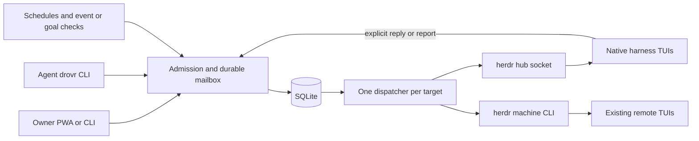

# Codex proposed design

drovr should be a durable mailbox, profile manager, and attention view for native agents in herdr. Its router admits work, records attempts to submit it, and accepts explicit results. herdr continues to own the terminals and native session resume.

This is an alternative to [plan-proposed.md](plan-proposed.md) and a revision of the direction in [claude-proposed.md](claude-proposed.md). The reasoning and source checks are in [codex-review.md](codex-review.md). This is a design specification; none of its runtime acceptance gates have passed yet.

## Product contract

Keep the README's release scope:

- One user, one hub, and existing herdr machines.
- Persistent profiles with instructions, MCP, skills, a harness, and required environment names. Existing harness logins stay in place.
- Direct messages to profiles and ordinary agents, with history per pair, an advisory allow list, and no rooms.
- Hub profiles that wake from schedules, events, and periodic checks of standing goals. Every wake enters that profile's own interactive TUI.
- A phone and desktop PWA showing work, questions, explicit results, profiles, messages, and access to panes.
- No headless agent turns, SDK orchestration loop, classifier model, container fleet, or replacement for herdr's restore and SSH facilities.

Change the transport contract: a recorded submission is distinct from an agent's recorded answer. drovr can deduplicate its own requests and results. It cannot guarantee exactly-once execution of a prompt inside an arbitrary TUI. An ambiguous submission becomes visible work for the owner; it is not silently repeated.

Automatic delivery also requires a cooperative handoff of the target pane. A shared pane remains messageable, but queued messages wait for the owner to deliver them deliberately. An ordinary agent can be handed to automatic delivery without becoming a profile. This is a deliberate restriction on the original “ready means safe to type” rule.

## Shape of the implementation

Keep one TypeScript/Node service, a small CLI, and static PWA assets served from the same origin. Keep SQLite with a single service writer and the existing proposals' mature SQLite binding choice. Pin runtime, binding, herdr, and harness versions when recording compatibility results; a later version is not implicitly supported.

The service has five modules, which share the same process and database:

| Module | Responsibility |
| --- | --- |
| herdr adapter | Snapshot, events, launch, prompt, screen read, explicit key actions, terminal stream; capability and version checks |
| Profiles | Validate files, calculate revisions, materialize harness files, match owned runtime, launch once |
| Mailbox/router | Actors, admission, permissions, durable queue, attempts, results, cancellation, and bounded delivery |
| Triggers | Deterministic checks and due occurrences, all producing mailbox entries |
| HTTP/UI | Pairing, Attention, profiles, messages, pane access, and explicit owner decisions |

The hub adapter uses the socket and periodic reconciliation. Events accelerate refresh; they are not a permanent log. The remote adapter uses the documented `herdr --machine` commands, with bounded concurrency and backoff. It offers snapshots, prompts, and bounded reads. Remote streaming is not promised by that adapter.



An operating-system service lock prevents a second dispatcher using the same state directory. This is one supervised service, not a replicated work queue. Persist intent before external actions even with that single writer.

## Profiles and their workspaces

```text
~/.config/drovr/
  drovr.json                       machine aliases and service defaults
  profiles/<name>/
    profile.json                   harness, workspace references, environment names
    AGENTS.md                      profile instructions
    mcp.json                       supported common MCP definitions
    skills/<name>/SKILL.md
    native/<harness>/...           validated native settings
    triggers.json

~/.local/share/drovr/
  drovr.sqlite
  revisions/<digest>/...           accepted effective profile material
  runs/<profile-id>/              stable harness cwd and generated native files
    api/                          optional dedicated Git worktree
```

Names follow herdr's agent-name syntax. Each profile also has a stable internal id. Names are addresses and display values; renaming a profile does not merge histories or transfer pending work to another profile. One profile has at most one managed live runtime.

For example, the proposed profile manifest is:

```json
{
  "harness": "codex",
  "required_env": ["GITHUB_TOKEN"],
  "workspaces": [
    { "id": "api", "path": "./api", "source": "~/src/api",
      "branch": "drovr/reviewer", "base_ref": "origin/main" }
  ]
}
```

This describes an optional worktree inside the managed run root. `base_ref` is explicit; provisioning does not fetch or guess a default branch. An existing owner-prepared checkout may instead be referenced by absolute path. The profile page shows whether a checkout is shared. Creation requires the owner to request it; an incoming message can launch a provisioned profile but cannot invent a branch, checkout, or workspace.

Use herdr's worktree facility where it supplies the required operation. Otherwise perform a narrow Git operation on explicit owner provisioning, with argv arguments and checked paths. Validate the resulting repository identity and branch. Never reset, clean, rebase, delete, or switch an existing worktree automatically. A collision or dirty conflicting workspace is a provisioning error. Removing a profile retains its code and branches.

The generated parent remains the harness cwd so profile files have a stable home and resume needs no profile flags. This makes an explicit tradeoff: a child repository's instructions and settings are not assumed to load as if the harness had started there. The generated instructions name every workspace and require reading its repository guidance before working there; the adapter supplies additional-directory settings when needed. Each coding operation uses the actual workspace as its command cwd. This bootstrap is cooperative guidance. It does not replace the harness's native discovery contract.

Before supporting an adapter, verify this exact layout with instruction sentinels, MCP and skill discovery, file edits, tests, and Git staging/commits. Linked worktrees have metadata outside their checkout; do not broaden permissions to the entire source repository to make a test pass. Show a native approval when required. If the layout fails discovery for a pinned harness, hold that adapter's release gate and choose a documented root/config arrangement explicitly. Do not silently omit the repository's instructions.

### Effective revisions and native settings

A profile revision is a digest of normalized manifest data, instruction bytes, skills and support files, supported MCP definitions, native settings, trigger definitions, and materializer version. Git commit ids can be shown as provenance; they are not the revision identifier. Reject traversal, unsupported file types, and conflicting reserved paths during validation.

SQLite records the accepted revision, desired revision, and applied revision. A valid file edit produces a candidate, and the owner activates it through the Profiles UI or administrative CLI. Activating executable checks is an explicit owner operation. Accepted material is snapshotted under its digest, so later edits cannot change the command that was reviewed. These are operational controls within a trusted OS account, not protection from another process with that account's full authority.

Materialize while the profile is stopped. Stage and validate all generated files first, journal the update, then replace the managed files and remove obsolete owned files. Never recursively erase the run directory. A materialization interrupted midway blocks launch until recovery completes. A live profile shows “new revision available”; it continues on its applied revision until the owner restarts it. Trigger execution also uses that applied revision, so an executable check cannot change ahead of the profile deployment. Avoid promising that resume rereads every setting or instruction.

Adapters own only their generated files: Claude `CLAUDE.md`, project MCP/settings/skills; Codex `AGENTS.md`, project config/skills; OpenCode 2 `AGENTS.md` and its native config/skills. Validate the exact keys against the pinned harness rather than copying a table from a different major version. A collision with an existing unowned file is an error. Native settings merge only through documented rules; replacing generated instructions, MCP ids, or protected settings requires an explicit conflict resolution. Nothing is blindly “copied last.”

Keep permissions in each harness's native format. The UI offers tested examples and shows the effective settings; it does not advertise identical `ask` or `workspace` enforcement across three different harnesses. Managed policies and user settings can still affect the result. Drovr message permissions and harness tool approvals remain separate.

Never relocate `CODEX_HOME`, `CLAUDE_CONFIG_DIR`, or the harness credential store. First-launch trust and MCP approvals are owner actions. Required environment checks run in the same environment used for actual launch and return presence or absence only. A different environment in the drovr service does not satisfy that check. Missing values block launch and name only the missing variables.

## Runtime identity and recovery

Use four different ids:

| Id | Meaning | Lifetime |
| --- | --- | --- |
| `actor_id` | A profile, or one enrolled ordinary agent | Persistent profile identity; ordinary actor ends when its agent incarnation ends |
| `runtime_generation` | An observed incarnation of an actor | Changes on replacement or uncertain continuity |
| `terminal_id` and public pane id | Where the actor currently runs | herdr runtime/location; public pane ids may move |
| harness session reference | Conversation to resume or display | May change within the same live actor |

A machine identity includes the saved machine profile id and the herdr session namespace. `@alias/name` maps to that pair, not to an arbitrary SSH hostname or label. The hub is one such namespace. Observation epochs scope state sequences and terminal ids; they are not globally comparable clocks.

Addressing follows the earlier plans: bare `@name` prefers a hub profile, `@agent:name` forces a live agent, and `@alias/name` targets a remote live agent. A pane address is accepted only when a current actor can be bound to it. If an ordinary name has no current occupant, reject it as unavailable. Do not wait an hour to send to whoever later takes that string.

A queued profile request belongs to the profile and can survive an observed `/clear` or a managed relaunch. Log the conversation boundary. A queued ordinary-agent request belongs to its observed generation. Apply the same rule to the return address of an ask. A result intended for a vanished asker remains in history and does not wake its successor.

After a herdr restart, wait for herdr's native restore. Match a managed profile only when harness kind, saved session, expected cwd, and absence of a conflicting runtime agree. Session equality alone is insufficient. If matching is ambiguous, show a recovery card. If no valid session was saved or resume failed, let the owner choose resume repair or a fresh session. Do not race herdr with a second launch or substitute a fresh conversation silently.

After an event gap, reconcile a snapshot. Equal ordinary-agent names or terminal ids do not prove that no replacement occurred during the gap. Freeze affected queued deliveries until continuity can be established or the owner resends to the current occupant. Remote snapshots have this limitation even on a healthy connection. For reliable unattended remote generation tracking, require an additional incarnation/registration mechanism; until verified, remote shared targets use explicit owner delivery. Do not imply that polling alone supplies it.

Persist a launch intent per profile before creating a pane. If a launch response is lost, reconcile it before creating another pane. A known empty shell is different from an unknown launch outcome. Reapply a missing profile name only after the runtime match succeeds.

## Messages and results

Keep the useful Claude protocol, add an explicit delivery close, and make retries idempotent:

```text
drovr ask @reviewer --text-file question.txt
drovr tell @builder --text-file update.txt
drovr reply <message-id> --delivery <delivery-id> --text-file answer.txt
drovr report <message-id> --delivery <delivery-id> --text-file summary.txt
drovr report <message-id> --delivery <delivery-id> --quiet
drovr finish <delivery-id>
drovr inbox
```

The CLI also supports short positional text. Files or stdin handle long text without having the model construct shell-escaped paragraphs. CLI requests carry a persistent request key for network retries. The same key and payload return the same row; a changed payload under that key is a conflict. Structured JSON output is available for tools.

`ask` returns a durable message id immediately. The expected result is one explicit `reply`. `tell` expects no answer. `report` records the outcome of a trigger or an owner task, including quiet completion and optional structured choices. Results are not inferred from ordinary assistant commentary.

`finish` explicitly closes processing of the delivery after the agent has submitted its results. Any asks still without a reply become `unanswered`; triggers without a report become `unreported`. The header includes the exact commands and ids. A result records its semantic fact immediately, even if the rest of a batch is still running. `finish` does not send keystrokes or claim that the harness itself is idle; the next delivery also waits for readiness.

For ordinary agents that have not installed the skill, the owner can send a tell and observe the pane. An ask still needs `drovr reply`, or an owner-authored result clearly marked as such. The owner can inspect the terminal and close an unanswered delivery. Silent extraction from that agent's final text is not an automatic fallback.

A delivery that returns to an apparent prompt without `finish` shows “pane ready; delivery not closed.” It does not immediately become an unanswered request. At a deadline it becomes `result_overdue` and needs a decision. A bounded default of one hour is reasonable for asks and reports; the sender may set a different supported deadline. Expiry does not assert that no side effect occurred. A late result is preserved and labeled late; a cancelled or expired request does not create an automatic new wake.

The result table has a unique key for the request's accepted result. A retry returns that result. A different second answer is rejected with a link to the original; an explicit amendment can append history without sending a new `tell`. A response to an ask is authorized as the completion of that ask and bound recipient, rather than requiring a new reverse allow-list approval. Any unrelated new question still goes through normal admission.

Replies always enter a durable inbox. An asynchronous reply may enqueue one tell-like notification to the bound asker, without inviting a response. It carries the original root context, and no assistant text is automatically relayed back. If the asker changed context or incarnation, retain the result in the inbox and show the owner instead of injecting it blindly.

Optional `--wait` is an optimization over this protocol. Add it only after the asynchronous path works. Waiting does not remove the durable result. A consumer claim/ack prevents simultaneous stdout and prompt delivery; a crash can release an unacknowledged claim back to the inbox. If the result was printed just before the CLI died, it is still retrievable by id and may be seen twice. It never causes the original ask to run again. Detect self-asks and arbitrary cycles in the wait graph, and return pending instead of holding the tool call. The default stays nonblocking.

### Headers and provenance

For example:

```text
[drovr delivery d72; ask m41 from @builder; another agent]
Does PR 12 change the retry contract?

Reply with: drovr reply m41 --delivery d72 --text-file <file>
After processing this delivery: drovr finish d72
```

Owner tasks, agent messages, schedules, and outside event data retain distinct origins in the database and header. A trigger's instruction was configured by the owner; its event payload was not. Render external content as data. This labeling helps the agent interpret it; it does not enforce a new model trust boundary.

## Delivery, uncertainty, and human takeover

There is one in-flight delivery per runtime generation. Initially send one mailbox item per delivery; this makes correlation and failure tests simpler. Bounded batching can follow within v1 after the one-item path passes. A batch retains each item's id, origin, root, result requirement, and cancellation state. It never broadcasts one undifferentiated final answer to every sender.

Before dispatch, check a fresh runtime observation, binding, pause/cancellation generation, applied profile revision, ownership mode, and launch readiness. Hold while working, blocked, unknown, stale, launching, or unresolved. Check `interactive_ready` where supported. A finite launch deadline produces a recovery card, not blind typing.

| Delivery state | Meaning | Recovery |
| --- | --- | --- |
| `queued` | Admitted; no attempt yet | Revalidate and dispatch when eligible |
| `held` | Owner approval, shared mode, pause, or uncertain identity prevents an attempt | Resolve the named reason |
| `prepared` | Attempt and payload committed before calling herdr | On recovery, it may have been sent; inspect and classify |
| `submitted` | herdr acknowledged the PTY submission | Await explicit result/finish; never infer consumption from the acknowledgment |
| `delivery_unknown` | The attempt might have reached the TUI | Hold further automatic work; owner may inspect, accept a later result, or retry explicitly |
| `closed` | Explicit finish or owner close recorded | Keep result outcomes and history |
| `cancelled` | Drovr will initiate no further attempt | Preserve whether an earlier attempt may have occurred |

Commit `prepared` and the full payload hash, target binding, observation baseline, and attempt number before the external call. After acknowledgment, commit `submitted`. A crash in between is uncertain even if SQLite is intact. A validation failure documented to happen before any write may return the item to queued. A timeout, connection loss, or a generic submission failure requires classification; do not assume it was pre-write.

Screen/transcript presence can help investigate an attempt. Absence is never sufficient evidence to retry it. An explicit `reply`, `report`, or `finish` referencing the attempt can resolve uncertainty. The UI's Retry action records the owner's decision and a new attempt against the freshly resolved target; it explains that the earlier action may already have run. Use stable message ids across these attempts so duplicate results stay deduplicated.

The initial total prompt limit is 16 KiB of encoded UTF-8, including headers and commands. Reject an oversized single item with a useful error; do not split one instruction across turns. A later batch fills only within that bound. Readiness observations help schedule writes, but no local check removes the state-change race between observing herdr and writing to it. Keep that limitation visible in compatibility results.

### Automatic and shared modes

Automatic mode is an owner agreement that drovr controls submissions to that pane. It is the default offered when handing a managed profile to background work. Shared mode is the default for discovered ordinary panes. Merely naming an agent does not enroll it for automatic typing.

“Take over” first pauses dispatch and waits for any current submission attempt to be classified, then opens the terminal. “Return to automation” asks the owner to leave an empty composer and explicitly hands it back. Drovr's own terminal input control respects that handoff. An attached native herdr client can still type; drovr cannot enforce exclusion against it under the pinned API. Focus and output activity can be useful hints, never ownership proofs.

In shared mode a card shows pending text and opens the pane for deliberate delivery. The owner checks the current composer before submission. No timer clears drafts, presses Enter, or assumes silence equals consent. If a future herdr version supplies conditional submission with a draft/identity guard, add it through a capability-tested adapter and then consider widening automatic use.

### Interrupt, Stop, and pause

Offer separate owner controls:

- **Interrupt:** request the tested native interrupt sequence for the current runtime. Keep future automation unchanged.
- **Stop:** persist `automation_paused`, increment its cancellation generation, cancel queued deliveries and pending trigger wakes, then request the interrupt. This is the prominent control.
- **Resume automation:** explicitly clear the pause after reconciliation; schedule from the current time, without a catch-up burst.

No new automatic launch or prompt may pass the cancellation-generation check after Stop commits. An external write already in progress may still finish; report that attempt rather than pretending cancellation retracts it. Pause survives both service and herdr restarts. Incoming messages can be retained as held; triggers do not accumulate paused occurrences.

Use per-harness, per-version interrupt sequences measured in the spike. Escape for Claude/Codex and double Escape for OpenCode are candidates from the Claude review, not a substitute for installed-version tests. Ctrl+C is not a generic Stop implementation. Blocked panes require an explicit dialog action or cancellation decision; background Stop must not approve them.

## Admission, lineage, and bounds

Owner messages are allowed. Agent messages pass an allow rule or wait for Allow once, Always allow, or Refuse. Bind the request before approval, and revalidate its binding when the owner answers. An approval never transfers a queued ordinary message to a new occupant. Persist the decision and rule revision. Revoking a rule holds queued items admitted through that rule; it cannot retract an already submitted prompt.

Every agent-sent child carries a server-issued delivery context. Persist `root_id`, `parent_id`, and depth; results retain the root on stdout and asynchronous notification paths. Only an owner action creates an owner root or resets its budget. Commands issued in a known active delivery inherit its context; do not reset lineage just because a pane settled or the service restarted. If causal context is unavailable, record that fact and apply the sender's independent rate budget instead of claiming a proven chain bound.

Initial defaults are depth 4, at most 16 accepted child sends per root, at most 64 pending items per actor, and at most 4 proactive deliveries per profile per rolling hour across all triggers. Add a configurable budget for agent-initiated new roots; start with 4 per sender per rolling hour. Owner actions can exceed a budget deliberately. Exceeding a bound produces a logged held/refused outcome, not another agent wake. Fair scheduling prevents automated traffic from starving owner messages.

These bounds manage accidental loops and cost. They do not constrain an agent that bypasses drovr through the owner's shell or herdr socket. Environment attribution and machine tokens are useful within that trust model; they are not proof against same-user impersonation.

## One trigger mechanism for proactive v1

Each accepted trigger names a hub profile, a cadence or event source, an owner-authored prompt, and a coalescing policy. Schedules, local changes, GitHub changes, and standing goals all enqueue ordinary mailbox items with a required report.

```json
[
  { "id": "morning", "cron": "30 7 * * 1-5", "timezone": "America/Chicago",
    "brief": true, "prompt": "Summarize changes and decisions needed in api." },
  { "id": "ci", "every": "5m", "coalesce": "latest",
    "check": { "command": ["gh", "run", "list", "-R", "owner/api", "-b", "main",
                            "-L", "20", "--json", "databaseId,status,conclusion,updatedAt"] },
    "prompt": "Inspect the changed CI state. Report only what needs attention." },
  { "id": "docs", "every": "3h", "coalesce": "latest",
    "check": { "workspace": "api", "mode": "content", "include": ["src/**"] },
    "prompt": "Keep documentation aligned with the source. Report quietly if no action is needed." }
]
```

These are proposed drovr config shapes. They are not harness configuration examples. A standing goal is a prompt plus a recurring input check; it needs no separate worker or agent runtime. All triggers pass the same profile pause, ownership, readiness, queue, and cost rules as messages.

### Checks and fingerprints

Support three precise check types:

| Check | Fingerprint | Limits |
| --- | --- | --- |
| `revision` | Named local ref/HEAD id | Notices committed changes only; fetching remote state is a separate explicit operation |
| `content` | Sorted canonical paths, file type/mode and content digests, including declared dirty/untracked inputs and deletions | Bounded file count/bytes; excludes Git metadata, native generated files, caches, and configured output paths |
| `command` | Full bounded stdout bytes, or canonical JSON when declared | Owner-activated argv, explicit cwd, timeout and output cap; nonzero exit is an error, not a changed input |

Content checks use metadata as a cache hint only; a cache that cannot establish unchanged content must rehash it. A same-size edit or repeated edit to an already-dirty file must change the fingerprint. Do not follow an undeclared symlink out of the input boundary. Explicitly configure ignored files and submodules if they matter. Failure or limit exhaustion holds the check with a visible error; it never silently adopts a partial fingerprint.

Command checks run under the service's ordinary authority. Their approved revision includes command, arguments, cwd, environment-name references, and normalization. A shell is used only when explicitly configured as the command. Limit checks to 30 seconds and 1 MiB of output initially; kill timed-out process groups and retain a bounded error. Normalize volatile timestamps when they are irrelevant. Hash the accepted full result before reducing the prompt payload to 4 KiB.

The first successful observation establishes a baseline without waking unless the owner set `fire_on_start`. Keep separate `last_observed`, `pending`, and `last_delivered` fingerprints. Atomically insert/update a pending wake and its cursor. Cancelling or failing delivery does not count as successful processing. An unchanged hash suppresses a prompt; `report --quiet` records completed processing with no result card. Repeated check errors appear in Attention without model calls.

### Cadence, coalescing, and restart

An interval check can run as often as once per minute. A trigger can submit at most one wake per 15 minutes, and the per-profile proactive budget also applies. While a profile is busy, keep at most one pending snapshot wake per trigger. Changes replace its pending snapshot until dispatch; never mutate a payload that has already been prepared for submission.

`latest` is appropriate for “what is CI's current state?” It is not a reliable event ledger. For independent PR/issue events, require `coalesce: batch`, retain unique source event ids in a bounded batch, and show overflow explicitly. Never drop distinct events by replacing them all with the last PR title. A polling check based only on the latest N rows can miss intermediate events; state that limitation or implement a paginated cursor for an event-ledger source.

Store due times in UTC and the trigger's IANA zone. Use a tested cron library. Define daylight-saving behavior: skip nonexistent local times; for a repeated local minute, fire once using its local occurrence key. Interval schedules use a persisted UTC anchor. Occurrence keys are unique by trigger revision and due occurrence, and prevent duplicate enqueue after restart. Editing or replacing a trigger resets its baseline deliberately and retains its old run history.

After service downtime, fire an unrecorded tick at most five minutes late and skip older ticks. After Pause, skip the paused occurrences. Pending snapshot wakes expire after 30 minutes by default and are refreshed from a new successful check before later delivery. Briefs have one result slot per profile and local date; a later explicit retry is an amendment to that day's brief, not another scheduled model call.

### Event sources and ingress

For the first release, use local checks and outbound GitHub polling through the owner's existing tools. A private `POST /events/:source` can accept events from an explicitly enrolled local/tailnet producer, using a source-scoped token and deduplication key. Commit receipt and enqueue before returning success. This supplies webhook-style local integrations without exposing the owner API publicly.

This proposal defers *public GitHub webhook ingress*, replacing it with polling in v1. That changes latency and may require cursors to preserve intermediate events. It preserves the README's proactive event behavior through local watchers and polling. If immediate public GitHub hooks are a release requirement, add a dedicated ingress slice before calling v1 complete: expose only its route, require raw-body HMAC validation with a retrievable secret, repository and event filters, bounded bodies, and atomic receipt/enqueue deduplication scoped by source and body digest. A hash-only stored secret cannot verify GitHub's HMAC. Do not expose the whole PWA API to make this work.

## Persistence

Persist decisions and transitions that cannot be reconstructed. Keep live snapshots in memory. The schema should follow those responsibilities rather than a target table count.

| Store | Durable facts |
| --- | --- |
| `actors` and profile deployment rows | Stable ids, names, accepted/applied revisions, pause/cancellation generation, ownership mode, saved resume references |
| `messages` | Request key, kind, source and target actor/generation, historical addresses, body, root/parent/depth, admission, expiry |
| `deliveries`, `delivery_items`, `attempts` | Prepared payloads, exact bindings, external calls, acknowledgment/uncertainty, explicit close, retry decisions |
| `results` and inbox receipts | Unique answers/reports, quiet/choices, amendments, claims and acknowledgments |
| `allow_rules` and decisions | Rules, one-time decisions, refusals, revocations |
| `trigger_state` and occurrences | Cursor/baselines, pending fingerprint, unique occurrence keys, source receipt ids, skip/error reasons |
| `devices` and source credentials | Hashed bearer credentials, role/scope, expiry/revocation; secret-store references where raw secret retrieval is necessary |
| `dismissals` | Durable Attention item keys and owner acknowledgment |

Use foreign keys, uniqueness constraints for request/result/occurrence identity, and explicit schema migrations. WAL is useful, but journal mode alone is not the recovery contract; test crashes around each external write. Back up the database through SQLite's supported consistent-backup path and include accepted profile revisions. Keep conversation bodies and credential values out of routine diagnostic logs.

Message admission, delivery transport, and semantic result are separate facts. For example, an approved ask can have an uncertain attempt and a later explicit answer. Cancelling it must not erase that answer or claim its earlier side effect was undone. The UI derives an understandable state from these facts; one overloaded enum should not hide them.

## PWA and owner actions

Attention is the first view. A task card represents a mailbox request/delivery or a runtime that needs the owner; it does not certify that a coding goal was achieved.

| Bucket | Examples |
| --- | --- |
| Needs you | Harness question, off-list message, uncertain delivery, identity/launch recovery, overdue result, check error, paused work needing a decision |
| Working | Submitted work with no explicit finish, plus a working runtime badge |
| Ready for review | Explicit report/reply or owner-closed work with reviewable output |
| Resolved | Owner acknowledgment of that particular durable item |

A quiet report creates no result card. It does not hide a launch error, uncertain write, permission question, or overdue delivery. Fleet counts are derived without model calls. Briefs are saved reports. Dismissing a card updates drovr only; it never focuses a pane to change herdr's `done` state. Keys include durable item ids or runtime epoch plus observation identity, so a later event produces a new item.

The other views are Agents, Pane, Profiles, and Messages. Pane shows the durable drovr exchange, a clearly labeled bounded screen view, and the hub terminal stream. Transcript chat is an optional read adapter with its own compatibility gate; reader failure never changes routing. Remote panes show freshness and adapter limitations. Full transcript chat can ship independently of core messaging.

The composer uses a target chip. A leading `@name ` can select that target; mentions later in free text never reroute it. Render message text and terminal content safely as content, not application HTML. Offline pages display cached state as stale and disable mutating actions until reconnection; they do not queue hidden Stop or approval operations to run later.

Drovr's off-list approval card has exactly Allow once, Always allow, Refuse. Harness questions retain their own native meanings. Use a bounded pane screen read for a blocked dialog, not a full-history `agent read` assumption. Show specialized keys only for dialogs recognized on tested versions. Bind the action to the runtime generation and observed dialog/revision, reread before sending, and reject stale cards. An unknown dialog opens the terminal. Without an upstream conditional-key API a small race remains; do not advertise the card as a transaction on the dialog.

Pair devices through short-lived, one-use, rate-limited codes. The browser authenticates to loopback HTTPS through the owner's private front, with token revocation enforced on new requests and existing streams. Validate browser origins/Host, protect state-changing routes, and authenticate terminal streams before opening them. A short-lived stream ticket can avoid putting the long-lived device token in a WebSocket URL. Administrative and agent/source credentials have different API scopes. Do not cache credentials or private terminal data in the static app cache.

The local socket is restricted to the account. Pane ids and machine tokens remain attribution under the trusted same-user model, not isolation between agents. Stronger isolation would require a separate execution boundary and is outside this design. Push notifications are optional after the core phone workflow; if implemented, an opt-in count-only notification does not replace the durable Attention item.

## Implementation stages and release gates

All stages below contribute to the full v1. Stopping after the mailbox would leave the stated PWA and proactive requirements incomplete. Use simulated adapter/fault tests for deterministic state-machine behavior and real harness sessions for TUI/config compatibility; each proves a different thing.

### Stage 0 — Record compatibility and the unsafe cases

Write `docs/spike.md` during implementation with exact installed versions, OS, date, redacted commands, outcomes, and evidence. Test Claude Code, Codex, and the selected OpenCode 2 release. Do not stop the owner's active server to manufacture a cold restart; use an isolated herdr namespace.

Required evidence:

1. Fresh profile launch, every trust/MCP dialog, instruction sentinels, one discoverable skill and MCP tool, existing login retained, and environment presence in the actual pane.
2. The specified parent/worktree layout: both profile and repository guidance, command cwd, source edit, test run, staging/commit permissions, and no changes to unrelated checkouts.
3. `agent prompt` with an empty and non-empty composer, plus owner input racing delivery. Record the failure and the handoff limitation, not only the happy path.
4. Prompt acknowledgment, fast work-to-idle, blocked/unknown states, cancellation, output redraw, event loss, and a deliberately lost command response. Confirm screen absence cannot establish non-delivery.
5. `/clear` or `/new`, rename, same-name replacement in the same terminal, pane move, detach, cold restore, and resume failure. Record which observations actually distinguish them.
6. Explicit reply/report/finish over repeated asks, tells, quiet wakes, batched requests, interruption, and approval delays. Ten successful replies alone are insufficient; include omissions and duplicate CLI calls.
7. Interrupt keys while working, idle, composing, and blocked, without exiting the TUI or accepting a dialog.
8. One saved remote machine: snapshot/prompt/read support, server namespace, stale observations, same-name replacement between polls, and remote sender/result path.

Any failed adapter gate blocks that adapter's automatic mode. Retain manual pane use where it works. Do not call the three-harness release complete until its required compatibility evidence exists or the owner explicitly changes that release scope.

### Stage 1 — Durable local messaging and profiles

Implement profile activation/materialization, actors, CLI, attempts, explicit results, allow decisions, pause, and manual/automatic ownership. Start with one item per delivery. Acceptance includes:

- Ask/reply produces one recipient delivery and one accepted result; an answer does not start an automatic reply chain. Tells expect no answer.
- Repeating every CLI request/result key returns the same object. A conflicting result never turns into a tell.
- Fault injection before write, after write, and before local acknowledgment produces the specified queued/submitted/unknown states. Restart never silently resubmits an unknown attempt.
- A missing finish yields overdue work; a late reply remains visible. Owner close and explicit retry are recorded separately.
- `/clear` preserves profile-directed queued work; a replaced ordinary actor receives neither an old question nor an old answer. Observation gaps hold uncertain bindings.
- Stop pauses before queue cancellation, survives restart, rejects late check results, and prevents the next scheduled/agent automatic wake until explicit resume.
- Cold restore reconciles a single managed runtime, and a lost launch response never creates a second profile pane.
- Depth, fan-out, capacity, and rate limits apply across service restarts and asynchronous replies. Optional waits reject self-edges and longer cycles.

### Stage 2 — Phone and desktop operations

Ship pairing, Attention, Agents, Pane, Profiles, Messages, the hub terminal view, and owner decisions. Verify at phone and desktop widths, including offline, herdr-down, empty, stale remote, and expired/revoked-device states. Check that takeover pauses dispatch, stale approval cards cannot send keys to a known changed runtime, viewing a card leaves native focus alone, and ordinary mentions do not change the target. Pair history distinguishes actor identities that reused a name.

### Stage 3 — Proactive hub profiles

Ship cron, revision/content/command checks, event receipts, standing-goal prompts, report/quiet/choices, brief, and bounded batching if desired. Acceptance includes:

- No model prompt for unchanged inputs; a second edit to an already-dirty or untracked file does prompt. Configured output paths do not retrigger their own goal.
- Check failure, oversized output, and malformed data retain the previous good baseline and show an error. Failed checks do not become empty-payload wakes.
- Busy periods retain bounded work; latest-state and independent-event batching behave differently and preserve their declared data.
- Restart, two timer callbacks, clock changes, DST, paused periods, and skipped ticks never create duplicate occurrences or catch-up floods.
- Multiple triggers cannot evade the profile-wide wake budget. An unknown delivery prevents another automatic wake into that runtime.
- Quiet completion suppresses only its successful result card. A choice creates one durable owner message per action id, tied to the report that offered it; its submission attempts follow the same uncertainty contract as other messages.
- A GitHub polling source records its freshness, normalization, cursor or snapshot limitation, and report in the same profile TUI.

### Stage 4 — Existing remote agents and full release audit

Ship machine aliases, bounded polling, stale/error display, source-scoped remote CLI access, asks/tells/results to existing remote agents, and continuity handling. Never launch hub profiles remotely. An ordinary remote pane can receive explicit owner delivery without reliable incarnation tracking; unattended mode requires the additional generation gate described above.

Verify a remote question and return answer, reverse-address replacement, a dropped SSH response, unreachable-machine expiry, two servers with equal agent names, and a machine label containing spaces mapped through a short alias. Hub work must continue while one remote machine is unavailable.

The release audit maps every README capability to one of these observed outcomes. Retain unresolved limitations beside the relevant adapter. Token-use validation counts prompts and wake frequency first, then measures representative native sessions if usage is available. The reported 1.7× headless comparison remains the owner's motivation, not a universal benchmark or a promise of this design's savings.

## Work to defer deliberately

Public GitHub ingress unless explicitly included in the release gate; push; rooms and group semantics; arbitrary remote profile deployment; richer transcript viewers; a second model for routing; and a separate tool-policy language. Keep the ability to add those features without making them prerequisites for durable direct messages.

The immediate engineering decision is the delivery contract. If automatic writing into shared native composers is mandatory, resolve it with herdr before building the rest of the service around an unsafe assumption. With explicit pane handoff and visible uncertain delivery, the rest of this design can remain a small service around native TUIs.
