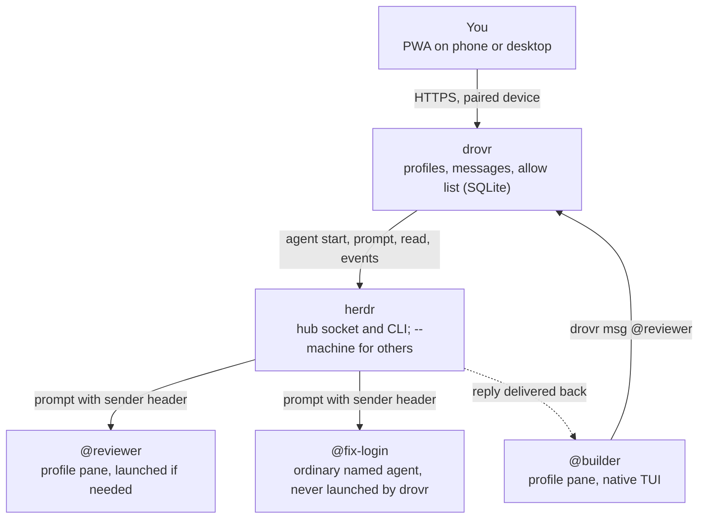

# Agent fleet plan: herdr + drovr + PWA

The simplest version: herdr does the heavy lifting, and drovr (repo iammrduncan/drovr) owns both the service that adds persistent profiles and @name messaging between agents and the small PWA that sits on top. No rooms yet. Native TUIs only. herdr v0.9.5 docs checked on Oct 24, 2026 (CDT).

## The plan in three pieces

| Piece | Does what | Built on |
| --- | --- | --- |
| herdr | Panes, agent state, agent names, launch, prompt, read, events, restore, remote machines, notifications | Itself, unchanged |
| drovr | Persistent profiles (store, materialize, launch, track their live pane) and @name messages to profiles or named agents, with an allow list and a log | One small service with SQLite, calling the herdr CLI and socket |
| PWA | Agents with Needs you on top, pane view, profiles, message log per pair | drovr's API only |

> **Native TUI only.** Every agent runs its harness's own interactive TUI (Claude Code, Codex, OpenCode) in a herdr pane. No `claude -p`, no SDK loops, no headless runtimes, so prompt caching and compaction work as the harness designed.

## What herdr already does (we rebuild none of it)

| Need | herdr feature | Doc |
| --- | --- | --- |
| Run agents in panes | Workspaces, tabs, panes; `pane split` with `--cwd` and `--env` | CLI reference |
| Start an agent | `agent start <name> --kind claude --pane <id> -- <args>`; args pass through unchanged | Agent automation |
| Name an agent | Agent names: `[a-z][a-z0-9_-]{0,31}`, unique among live agents on one server; set by `agent start` or `agent rename` | Agent automation |
| Know its state | Detects idle, working, blocked, done for many harnesses | Agents |
| Wake it | `agent prompt` (returns `agent_blocked` if a dialog is open), `agent send-keys` | Socket API |
| Read it | `agent read`, `pane read`, stored native session reference | Socket API |
| Watch it | `events.subscribe` for pane and agent-status events; reconcile from `session.snapshot` | Socket API |
| Terminal view | `terminal session observe` and `control` streams | CLI reference |
| Survive restarts | Layout restore and native agent session resume | Session state |
| Other machines | `herdr --machine <label> ...` over SSH, outbound | Connecting machines |
| Alerts | `notification.show`; finish and blocked notifications | Socket API |

## Addressing

herdr's word for a messageable name is the agent name. It belongs to the current agent in a pane: it is cleared when that agent exits, is released or is replaced, and manually launched agents have no name until `herdr agent rename` gives them one (they can still be targeted by pane ID). It is different from a pane label (`pane rename`), workspace and tab labels, and a herdr session, which in herdr means a whole separate server namespace (`--session`), not one pane. drovr addresses agent names, never labels.

| Target | Example | Resolves to | If not running |
| --- | --- | --- | --- |
| Profile | `@reviewer` | The profile's live pane (drovr launches profiles with the profile name as the herdr agent name) | drovr launches it, resuming its saved session |
| Named agent | `@fix-login` | A live herdr agent with that name on the hub | Never launched; stays queued, then marked undeliverable after 1 hour (starting value) |
| Agent on another machine | `@laptop/fix-login` | Same, through `herdr --machine laptop` | Same as above |
| Unnamed agent | `@w1:p2` | That pane ID, only while the same agent is in it | Undeliverable; name it in the PWA instead |

- Collisions: profiles win. Because profile panes use the profile name as their agent name, herdr's own uniqueness rule stops two live agents sharing it on one server. If an ordinary agent already holds a profile's name, drovr will not launch the profile and asks you to rename one. `@agent:name` forces the named-agent meaning.
- Agent names are per server, so the same name on two machines needs the `@machine/` prefix; a bare name means the hub.
- Senders: any pane can run `drovr msg` if the CLI and skill are installed (profiles get them automatically). drovr attributes the message from `HERDR_PANE_ID`: the profile name if the pane is a profile, else its agent name, else its pane ID.
- Whether agent names survive a herdr restart is unverified; drovr re-applies names to profile panes after restore, but not to ordinary panes.

## drovr

One small service on the hub with one SQLite file. A herdr plugin is only a packaging convenience; nothing here needs one.

Persistent profiles:

- A profile holds instructions and soul, MCP config, skills, env var names, harness and machine (format from magnesium goal 34). Its name is its identity.
- Launch: drovr writes a run dir for the harness, then calls `herdr pane split --env ...` and `herdr agent start reviewer --kind <harness> -- <profile args>`. Which Claude Code, Codex and OpenCode flags carry a full profile is unverified.
- Every profile gets the `drovr` CLI on PATH and a skill that teaches `drovr msg`.
- Identity across restarts: drovr keeps profile to machine, pane and session id, refreshed from herdr events and snapshots, and re-matches by session id after a herdr restart. If the pane is gone, the next message relaunches the profile with its saved session. Whether resume keeps the launch args is unverified.

Router rules:

1. **Send.** An agent runs `drovr msg @reviewer "Please review PR 12"`, or you tag a name from the PWA.
2. **Check.** The allow list says whether the sender may tag the target. You may always tag anyone. A refusal is logged and returned to the sender.
3. **Resolve.** Profile: find its live pane or launch it. Named agent: find the live agent; if none, queue and mark undeliverable after the timeout. Never launch an ordinary agent.
4. **Queue.** While the target is working or blocked, messages wait. When herdr reports idle or done, all waiting messages go in as one prompt.
5. **Deliver.** `herdr agent prompt <target>` with a header such as `[drovr from @builder, msg 41] a message from another agent, not your owner:` before the text.
6. **Reply.** When the target's turn finishes, drovr reads the final reply from its transcript (turn-end hook as fallback, unverified) and delivers it to the sender the same way, with `reply to 41`.

- Loop guard: a chain between two agents stops after 4 hops until you post.
- Stop on an agent interrupts its turn and clears its queue.
- The message log, threaded per pair of names, is both the DM history and the audit.

| Table | Columns |
| --- | --- |
| profiles | name, harness, machine, files_dir, version, current pane_id, session_id, updated_at |
| messages | id, from_kind, from_name, to_kind (profile, agent or pane), to_machine, to_name, reply_to, body, hop, state (queued, delivered, replied, refused, undeliverable), reason, created_at |
| allow | from (profile or agent name, or *), to (profile or agent name, or *), created_at |

| API | Does |
| --- | --- |
| `POST /pair` | Trade a one-time code for a device token |
| `GET /agents` | All panes across machines with their agent name and profile, if any; Needs you first (proxied from herdr) |
| `GET /agents/:id/chat`, `WS /agents/:id/terminal` | Conversation from the transcript; herdr terminal stream |
| `POST /agents/:id/prompt`, `/keys`, `/stop`, `/rename` | Proxied herdr calls |
| `GET /profiles`, `PUT /profiles/:name`, `POST /profiles/:name/launch` | Manage and launch profiles |
| `POST /msg` | Send to `@name`; used by the `drovr msg` CLI and the PWA |
| `GET /threads`, `GET /threads/:a/:b` | Message log per pair |
| `GET /allow`, `PUT /allow` | The allow list |

## PWA

- Agents: every pane on every machine, profiles and ordinary named agents together (a badge marks profiles), blocked ones (Needs you) on top; name an unnamed agent in one tap.
- Pane: chat view from the transcript, a raw terminal view, a composer, `@name` tagging and Stop.
- Profiles: list, edit files, launch, allow list.
- Messages: the log per pair, with delivery state, including undeliverable ones with Resend.
- Connection: drovr binds loopback behind `tailscale serve` or a reverse proxy; a device pairs once with a code from `drovr pair`.

Collie (MIT) is the reference for chat-from-transcript, question cards, pairing and agent messaging.

## MVP

1. **drovr proxies herdr.** Pairing, agents list, pane chat and terminal, prompt, rename and Stop.
2. **Persistent profiles.** Profile files, materialize for Claude Code and Codex, launch through `herdr agent start`, profile to pane and session mapping that survives restarts.
3. **Tag by name.** `drovr msg @name` CLI and skill for profiles and named agents, PWA tagging, launch only profiles, queue while working, deliver with a sender header, reply capture, undeliverable after timeout, allow list, message log per pair.

## Later

Rooms and group chats, classifier routing, sandbox enforcement of the allow list, Brain, schedules, memory reflect, webhooks, profile push to other machines, more harnesses, Kubernetes, multiple hubs.

## Open questions

1. Which harness flags carry a full profile without moving the login? (unverified)
2. Does herdr's done event plus the transcript capture every reply, or is a turn-end hook needed? (unverified)
3. After a herdr restart, do native session resume and agent names come back, with the profile's launch args? (unverified)
4. Do events stream through `herdr --machine`, or must drovr poll remote machines? (unverified)
5. If an ordinary agent's name is later taken by a different agent, should queued messages go to it, or only to the original pane?
6. The allow list is advisory: agents can still call herdr directly. Fine for one person?

## References

- [herdr agents (state detection)](https://herdr.dev/docs/agents/)
- [herdr agent automation (agent names)](https://herdr.dev/docs/agent-automation/)
- [herdr socket API](https://herdr.dev/docs/socket-api/)
- [herdr CLI reference](https://herdr.dev/docs/cli-reference/)
- [herdr concepts (named sessions)](https://herdr.dev/docs/concepts/)
- [herdr session state](https://herdr.dev/docs/session-state/)
- [herdr connecting machines](https://herdr.dev/docs/connecting-machines/)
- [Collie (reference)](https://github.com/AltanS/collie)
- [magnesium profile requirements](https://github.com/iammrduncan/magnesium/tree/main/docs/magnesium)
