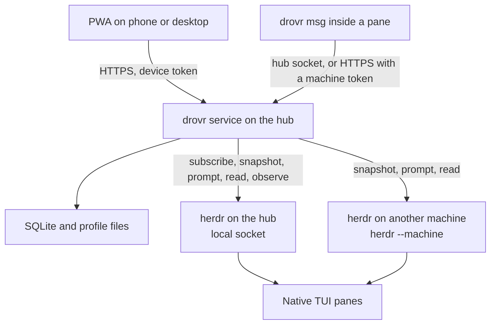

# Proposed design

drovr is two programs in one repo: a small service on the hub, and a web app that service serves. herdr runs the agents. drovr remembers profiles, decides when a message may wake an agent, and gives one person a phone and desktop view of the fleet.

This design keeps the [original plan](plan-original.md). The differences are listed first, then the design those differences imply. Evidence is in the [review](plan-review.md).

## Where this differs from the plan

1. **A profile is files in a directory, not launch flags.** herdr's cold resume command is only `claude --resume <id>`, `codex resume <id>`, or `opencode --session <id>`. Extra arguments and `pane split --env` are not restored. `CLAUDE_CONFIG_DIR` and `CODEX_HOME` would move the login. Claude records `--append-system-prompt` on the first request and ignores a different value on resume until compaction. The service writes instructions, MCP, and skills into the run directory and starts the harness with no profile flags.

2. **The reply is transcript text after a herdr settle, not a hook and not the screen.** The wake signal is a new `completion_seq` (idle or done) after the prompt was accepted. The body is assistant text appended to that session's transcript after the prompt. herdr 0.9.5 does not install a Claude or Codex turn hook. Codex's were removed after they warned on startup, and Claude's integration keeps `SessionStart` only. The screen is incomplete for full-screen TUIs. A turn that ends blocked is not a reply.

3. **Automatic replies are hub conversations, and only for the turn drovr just started.** Two hub agents can answer each other. A blocked turn is shown to the owner and is not relayed. The 4-hop cap stays. An agent on another machine receives the prompt. Its reply is relayed only when drovr can read that machine's transcript. Otherwise the message stays `delivered` and the pane view shows the screen excerpt. The remote agent can still reply by running `drovr msg`.

4. **A queued message belongs to one occupant.** It stores machine, name, pane id, and session id. A later agent that is given the same name does not receive it. An ordinary agent that exits makes the message undeliverable immediately. The one-hour wait remains for the same session coming back, including a profile drovr relaunches onto that session.

5. **Remote machines are polled. The hub is subscribed.** `herdr --machine` does not expose `events.subscribe` or `terminal session observe`. v1 streams the terminal for hub panes. Other machines contribute snapshots, prompts, and reads.

6. **v1 profiles launch on the hub only.** Other machines are targets for named agents that are already running. Pushing a profile directory to another machine is later, as the plan's Later list already says. The profile still records that it belongs on the hub, so the field is not a surprise when a second machine becomes possible.

7. **v1 does not import magnesium's sandbox, hook file, tool matrix, or multi-machine delivery.** The folder keeps instructions, skills, MCP, environment names, and harness. Goal 34 is the source of that folder, not the source of the rest of that app.

8. **Machine labels are not address syntax.** herdr labels can contain spaces and capitals. drovr stores a short alias for each saved machine and maps it to herdr's machine profile id.

9. **The allow list stays advisory, and the UI says so.** Agents can call herdr directly. That is acceptable for one person's machines. The log records drovr messages only.

10. **OpenCode joins Claude Code and Codex in the first profile stage.** herdr already resumes it, and the file-based materializer is the same shape. The plan's MVP step 2 named Claude and Codex only. Leaving OpenCode out would add a second materializer pass for a harness the requirements already include.

## Architecture



One Node process on the hub listens on `127.0.0.1` and on a user-only Unix socket. It serves the static PWA, the HTTP API, and the local CLI. It opens herdr's hub socket itself for `events.subscribe` and for commands. It shells out to `herdr --machine` for other machines. It does not embed a terminal multiplexer, an agent loop, or a second copy of herdr.

Long-running profiles run on the hub, in herdr panes, in the harness's own interactive TUI. drovr never starts `claude -p`, an Agent SDK loop, or a headless runtime.

Collie is a reference for the front door and for reading logs. It is not a dependency, and this repo does not fork it.

## Language and runtime

TypeScript on Node 24 LTS, one language for the service, the CLI, and the PWA.

The service is a Unix socket client, a small HTTP API, SQLite, and file writes. The PWA and the transcript readers are the larger half, and they are JSON. One language is the smaller thing to maintain. Node is already present on a machine that runs these harnesses. Bun would match Collie's runtime without buying anything drovr needs.

SQLite goes through `better-sqlite3`. Node's `node:sqlite` is still a release candidate in the Node 26 docs (stability 1.2 as of the 29 October 2026 docs). The message log is the only copy of DM history, so it stays on the mature binding. The native addon is built once on the hub.

Rust would match herdr and is a poor fit for a service this size. Go would make a tidy single binary and would split the repo into two languages for little gain. A herdr plugin is not the service. The process is supervised by the user's service manager and started after herdr.

The PWA is a Vite build of static files. The service serves `web/dist`. There is no second origin.

## Data model

Profile bodies live on disk, not in SQLite. SQLite points at them and holds the log.

```text
~/.local/share/drovr/
  drovr.sqlite
  profiles/<name>/
    profile.json          harness, model note, env names, version
    AGENTS.md             the instructions, one document
    mcp.json              servers, no secret values
    skills/<name>/SKILL.md
  runs/<name>/            the pane cwd for that one harness
```

A run directory holds only the files for the profile's harness. Claude gets `CLAUDE.md`, `.mcp.json`, and `.claude/skills/`. Codex gets `AGENTS.md`, `.codex/config.toml`, and `.agents/skills/`. OpenCode gets `AGENTS.md`, `opencode.json`, and `.opencode/skills/`. The same instruction text is written to whichever filename that harness reads.

`profile.json` holds names of environment variables. Values stay in the hub environment that herdr already passes into panes. A launch is refused when a required name is unset. The refusal names the variable and not the value.

SQLite, WAL mode, one writer:

| Table | Role |
| --- | --- |
| `profiles` | `name` primary key, `harness` (`claude`, `codex`, `opencode`), `version`, `files_dir`, `run_dir`, `env_names` JSON, `created_at`, `updated_at` |
| `profile_runtime` | `name`, `session_id`, `pane_id`, `terminal_id`, `managed` boolean, `last_completion_seq`, `updated_at`. Rebuilt from herdr whenever the snapshot says something else |
| `machines` | `alias` primary key, `herdr_profile_id`, `herdr_label`. The hub's alias is `hub` |
| `occupants` | `machine`, `agent_name`, `pane_id`, `session_id`, `kind` (`profile`, `agent`, `pane`), `harness`, `status`, `completion_seq`, `seen_at`. Snapshot rows, replaced on each reconcile |
| `messages` | `id`, `from_machine`, `from_kind`, `from_name`, `from_pane_id`, `from_session_id`, `to_machine`, `to_kind`, `to_name`, `to_pane_id`, `to_session_id`, `reply_to`, `body`, `hop`, `state`, `reason`, `batch_id`, `created_at`, `updated_at` |
| `allow` | `from_pattern`, `to_pattern`, `created_at`. A pattern is a profile or agent name, or `*` |
| `devices` | `id`, `token_hash`, `label`, `created_at`, `revoked_at` |

Message states: `queued`, `delivered`, `replied`, `refused`, `undeliverable`, `cancelled`. Stop moves queued rows for that occupant to `cancelled`. It does not delete them.

`to_session_id` is the occupant at send time. Delivery rechecks it. A profile relaunch may replace `to_pane_id` and must keep `to_session_id`.

The log is private in the same way herdr session files are private. Backups of this directory are backups of agent conversations.

## Router

The router is the only component that turns a message into a keystroke. The PWA, the CLI, and a future schedule all call it. It runs in the service process. Nothing else prompts an agent on drovr's behalf.

1. **Accept.** `drovr msg` or `POST /msg` submits a target and a body. The sender is the paired device, or the pane resolved from `HERDR_PANE_ID` on the hub socket. A remote CLI presents its machine token and its pane id; the service checks that pane with `herdr --machine`.
2. **Authorize.** The owner is always allowed. Any other sender must match an allow row. A miss is `refused`, logged, and returned to the sender. The list is not a herdr sandbox.
3. **Resolve.** Parse the target. A profile that is not running is launched, on the hub, resuming `profile_runtime.session_id` when there is one. An ordinary name that is not live becomes `undeliverable` as soon as the snapshot shows the previous occupant gone. A missing name with no prior occupant stays `queued` until the undeliverable timeout (one hour) in case that session reappears.
4. **Bind.** Store the target occupant. If the name later points at a different session id, the row does not follow it.
5. **Wait.** While the occupant is `working`, `blocked`, or `unknown`, leave the row queued. `unknown` is not permission to type. A `blocked` occupant is already in Needs you.
6. **Batch.** When the occupant is `idle` or `done`, and its `completion_seq` is the one observed before this batch, send every waiting row as one prompt, in order, under one header. Cap the batch around 16 KiB of body. Leave the rest queued. Record the `completion_seq` observed at send time.
7. **Deliver.** Call `agent prompt` with the header below. Use `--wait` only long enough to see `working` or a new settle, with a short stall timeout. On `agent_blocked`, put the batch back to `queued` and surface the pane. On `agent_prompt_stalled` or a timeout, read the pane before sending again. A second send of the same batch is a duplicate prompt.
8. **Capture.** On a later snapshot or event, if `completion_seq` is newer than the value stored at send time and status is `idle` or `done`, read the transcript from the offset saved at send time. The new assistant text is the reply. If the status is `blocked`, leave the messages `delivered` and do not synthesize a reply. If the transcript has not grown yet, retry a few times; herdr can report idle before the file is flushed.
9. **Relay.** If the reply is non-empty and `hop` is less than 4, enqueue it to the original sender with `reply to <id>` and `hop + 1`. The owner posting from the PWA resets the hop count. A chain that hits 4 is logged and stopped until the owner posts.
10. **Reconcile.** `events_lost`, a socket reconnect, or a herdr restart throws away the in-memory agent list. The next `session.snapshot` replaces `occupants`. In-flight waits are started again from the database. Messages stay queued until step 6 is true again.

Header, one line, then the body:

```text
[drovr from @builder, msg 41] a message from another agent, not your owner:
Please review PR 12
```

A reply uses `reply to 41` in that header. The profile skill tells the agent to answer the body and to send its own new requests with `drovr msg`, not by guessing pane ids.

Stop sends `ctrl+c` through `agent send-keys` only when the owner asks. It cancels that occupant's queue. It does not approve a dialog.

## Addressing

```text
@name                  hub profile or hub agent; profile wins if both exist
@agent:name            hub agent, never a profile launch
@alias/name            that machine's live agent; never launched
@alias/agent:name      same, explicit
@alias/w1:p2           that pane, only while the bound session is still in it
```

`name` matches herdr's agent-name pattern. `alias` matches `[a-z][a-z0-9-]{0,31}` and is drovr's, not herdr's label. The hub may be written `@hub/name`; a bare `@name` is the hub.

If an ordinary agent already holds a profile's name, launch fails and the PWA asks for a rename. drovr does not kill the other agent.

Senders on the hub are attributed from `HERDR_PANE_ID`: profile name, else agent name, else pane id. Unnamed senders can still send. Their messages show the pane id as the sender.

## Profile materialization

`profile.json` names one harness. The instructions are a single `AGENTS.md` in the profile. Materialize writes that text to the filename the harness reads: `CLAUDE.md` for Claude Code, `AGENTS.md` for Codex and OpenCode. Claude's docs allow `AGENTS.md` in place of `CLAUDE.md`. A Claude run directory still gets `CLAUDE.md`, so a non-git directory does not depend on that fallback. The same text is not also written to `AGENTS.md` in a Claude run directory. Stage 2 checks that the instruction sentence shows up once.

Skills are copied into that harness's discovery path only: `.claude/skills/`, `.agents/skills/`, or `.opencode/skills/`. The `drovr` skill is added there too. It documents `drovr msg` and the sender header. drovr does not edit `~/.claude`, `~/.codex`, or `~/.config/opencode`.

MCP from `mcp.json` is written to:

- Claude: `.mcp.json` in the run directory
- Codex: `.codex/config.toml` `[mcp_servers]`, which Codex loads only after the directory is trusted
- OpenCode 2: `opencode.json` `mcp.servers`

No `--mcp-config`, no `--strict-mcp-config`, no `--append-system-prompt`, no `OPENCODE_CONFIG`, no `CODEX_HOME`, no `CLAUDE_CONFIG_DIR`.

Launch:

1. Refresh `runs/<name>/` from the profile. Leave the directory in place across launches so the harness session stays associated with that cwd.
2. Codex ignores project `.codex/` config until that directory is trusted. If `agent start` returns `blocked` or `agent_not_ready`, show the pane and stop. Do not send keystrokes into the dialog. Stage 2 checks that the MCP server is actually visible after start, which fails if the directory was still untrusted.
3. `herdr pane split` into the run directory, `--no-focus`, with no extra env.
4. `herdr agent start <name> --kind <harness> --pane <id>` with no profile arguments.
5. Store the session id when herdr's `agent_session` appears.

On herdr restart, reconcile by session id. If herdr restored the managed name, keep it. If the pane is a shell and the session id is still valid, `agent start` with that harness's resume form is herdr's job when resume is enabled; drovr waits through the stagger (`startup_per_agent_delay_ms`, default 100 ms) and re-reads the snapshot. If herdr did not resume, drovr starts the harness in the same directory with the resume command herdr would have used, then renames the agent to the profile name. drovr does not pass the original empty argument list as if it were the profile.

Editing a profile bumps `version` and refreshes the run directory. A live session keeps running. The next launch, or the next prompt after OpenCode's instruction reload, picks up the files. Claude and Codex are not promised to reread instructions inside an already-open session. The PWA says the running session will see the edit on its next launch.

Environment names are checked, not injected. The herdr server's environment is the environment the pane inherits.

## Reply capture

| Harness | Locate | Read |
| --- | --- | --- |
| Claude Code | `~/.claude/projects/<encoded run dir>/<session id>.jsonl`, using Claude's published path encoding | New assistant records after the byte offset taken at send time. Tolerate a short trailing partial line. Treat the schema as unstable: the reader extracts plain assistant text and ignores records it does not know |
| Codex | A file under `~/.codex/sessions` whose name or contents contain herdr's session id. Confirm the filename once on a real session before coding the walker | Same offset rule |
| OpenCode | herdr's `ses_…` id. Prefer `opencode session export` if a direct read of `opencode.db` does not match the installed version. Pin the reader in the stage 2 acceptance test | New assistant parts after the send timestamp |

The offset is stored on the message batch. Capture never returns text from before it.

Hub files are local. For another machine, drovr may read the same path over SSH, using the target from `herdr machine list`, as the user who already has that SSH access. The read is the transcript file only. If SSH or the path fails, the batch stays `delivered` and the PWA shows `agent read` text. drovr does not ask the agent to write a side file just so the router can see the answer.

Subagent transcripts are not replies. Claude's integration ignores subagent sessions. OpenCode's integration keeps child sessions off the root id. The reader uses the root session id herdr stored.

## Security and pairing

One user. One hub. Every machine is one that person already reaches with SSH.

- The HTTP listener is `127.0.0.1` only. `tailscale serve` or a reverse proxy the owner runs is the HTTPS front. The service never enables a public funnel.
- `drovr pair` prints a short code. `POST /pair` exchanges it once, within a few minutes, for a device token. The database stores a hash. Revocation is a row, not a reinstall.
- The PWA sends the token on each request. The hub CLI uses the user-only Unix socket and needs no token. A CLI on another machine uses a machine token created the same way, installed mode `0600` by the owner.
- Profile directories are owner-readable. MCP config contains commands and URLs, not secret values.
- The allow list is shown as "who may use @name," with a line that agents can still drive herdr themselves.
- Prompt text is the message body the sender wrote. drovr does not add tool instructions that would approve herdr dialogs.
- Pairing codes, tokens, and environment values are not written to the service log.

## PWA

Four views. The service is the only backend.

**Agents.** Every pane herdr reports, hub first and then each polled machine. Profiles carry a badge. `blocked` is Needs you and sorts first. `done` is a second group, ready to read, because herdr keeps that distinct from idle. Unnamed agents can be named in one action, which calls `agent rename`. An unnamed pane is not a profile.

**Pane.** Chat from the transcript when the reader has a session id. A note when the view is a screen excerpt instead. Composer, `@` completion from the current agent list, and Stop. Hub panes also open a terminal stream from `terminal session observe`. Remote panes do not, until a later slice. The composer posts through the router when the body contains an `@` target, and through `agent prompt` when it is the owner talking to this pane.

**Profiles.** List, edit instructions, skills, and MCP, launch, and the allow list. A profile that is refused because a name is taken or an environment name is missing says why on the row.

**Messages.** One thread per pair of names, with state, including `undeliverable` and Resend. Resend creates a new message bound to whoever holds the name now. It does not reuse the old occupant binding.

Question cards are the blocked pane's visible prompt, from `agent read` of the detection or recent source, with actions that send keys the owner picks. drovr does not decide the answer.

The app is a PWA so a phone can install it. Desktop is the same build. Layout has to work at a phone width and at a desktop width. Empty, offline, and herdr-down states are real screens.

## Failure modes

| What happened | What drovr does |
| --- | --- |
| herdr hub socket is down | API returns a single unavailable error. The PWA shows herdr down. Queued messages stay queued. No retries in a tight loop |
| `events_lost` or dropped subscription | Resubscribe, replace occupants from `session.snapshot`, continue from SQLite |
| Remote machine SSH fails | That machine's agents go stale in the list. Hub profiles keep working. Messages to the machine stay queued until the undeliverable timeout, still bound to the last session id |
| `agent_blocked` on prompt | Do not type. Put the batch back to queued. Show Needs you |
| `agent_prompt_stalled` or timeout | Read before any retry. One automatic retry only if the transcript shows the prompt never arrived |
| Idle that is really an unknown dialog | Do not send a second prompt. The owner looks at the pane. Documented herdr behavior, not something drovr can fully detect |
| Codex trust prompt on first launch | Leave the pane blocked. Ask the owner to approve once. Do not send Enter |
| Resume id is stale | herdr restores a shell. drovr shows the profile as stopped. The next message starts a new session in the same run directory and keeps the old id in the log |
| Name collision with a profile | Do not launch. Ask for a rename |
| Same name, different session, queued message | `undeliverable`, reason `occupant changed` |
| Transcript file missing or mid-write | Retry briefly, then leave `delivered` with no relay |
| Batch larger than the paste limit | Send a prefix, keep the rest queued |
| Hop count reaches 4 | Stop the chain. The thread shows why |
| herdr cold restart during a queue | Rebind pane ids from the snapshot. Deliver only if the session id matches |
| Owner hits Stop | `ctrl+c` if a turn is in progress, cancel the queue, keep the log |
| Profile edit during a live session | Files update. The running session is not restarted. The UI says when the edit applies |
| Token leaked | Revoke the device row. The Unix socket on the hub is unchanged |
| Service restarts | SQLite is the queue. herdr keeps the panes. drovr resubscribes and reconciles |

## Staged MVP

Each stage is usable on its own. Acceptance is observed on the hub with a real herdr and a real harness, not a fake socket, except where a stage says a second machine.

### Stage 1. Proxy the hub

Pairing, the agent list, chat for a hub Claude Code session, a hub terminal stream, prompt, rename, and Stop.

Acceptance:

- A device pairs with a code and reaches the PWA over loopback HTTPS or `tailscale serve`. A second request with a revoked token fails.
- The agent list shows hub panes, with `blocked` above `done`, and `done` above idle and working.
- Opening a Claude pane shows prior turns from its JSONL, not from the screen.
- A prompt typed in the PWA appears in the TUI, and the following assistant text appears in the chat after herdr reports a new settle.
- Stop returns the pane to a prompt and does not delete the chat.
- Rename gives an unnamed agent a herdr name that `herdr agent get` accepts.
- With the herdr server stopped, the PWA shows unavailable and does not spin.

### Stage 2. Profiles

Profile files, materialize, launch, and restart for Claude Code, Codex, and OpenCode.

Acceptance, per harness:

- A profile whose instructions end with a fixed sentence produces that sentence in a new session, and the owner's existing login is still the one the harness uses. No login prompt, no `CLAUDE_CONFIG_DIR`, no `CODEX_HOME`.
- The run directory contains the instruction file, one MCP server from `mcp.json`, and one skill. The agent can name the skill.
- A missing environment name refuses launch and shows the name.
- After `herdr server stop` and start, with resume left on, the same session id is in `herdr agent get` and the profile name is the live agent name. The pane cwd is the run directory.
- If an ordinary agent already has the profile's name, launch does not happen and the UI says so.
- The first Codex launch's trust prompt, if it appears, is left for the owner. drovr does not press Enter.

### Stage 3. The router

`drovr msg`, the skill, PWA `@` targets, the allow list, and the log.

Acceptance:

- `@builder` on the hub can message `@reviewer` on the hub. reviewer is launched if needed. The prompt in reviewer's TUI starts with the sender header. reviewer's following assistant text is delivered back to builder as `reply to` that id, and both rows are in the pair thread.
- While reviewer is working, a second message stays `queued` and is included in one later prompt, not sent immediately.
- A third automatic reply stops at hop 4 until the owner posts.
- A message to a live ordinary name on the hub is delivered and is not preceded by `agent start`.
- Killing that ordinary agent makes a queued message `undeliverable`. Renaming a different agent to the same name does not receive it.
- An allow row that omits the sender returns `refused` to the sender and writes the row.
- The owner can message either agent from the PWA with no allow row.
- Resend on an undeliverable message creates a new row.
- A named agent on a second machine, reached with `herdr --machine`, receives a prompt. The hub list shows that agent from polling. If the remote transcript cannot be read, the message stays `delivered` and no reply is invented.
- The hub terminal stream still works. A remote pane has chat or a screen excerpt and no terminal socket.

## Later

Rooms and group chats, a classifier in front of the router, any real sandbox around the allow list, schedules, webhooks, profile directories on machines other than the hub, more harnesses, and more than one hub. None of these change the v1 data model if messages stay addressed to a single occupant.

## What this design refuses to build

- A headless agent runtime, `claude -p`, or an SDK loop.
- A second implementation of panes, detection, restore, or SSH machines.
- Rooms in v1.
- An allow list that claims to constrain herdr.
- Reply text taken from the terminal screen when a transcript read failed.
- Profile flags that only work until the next herdr restart.
